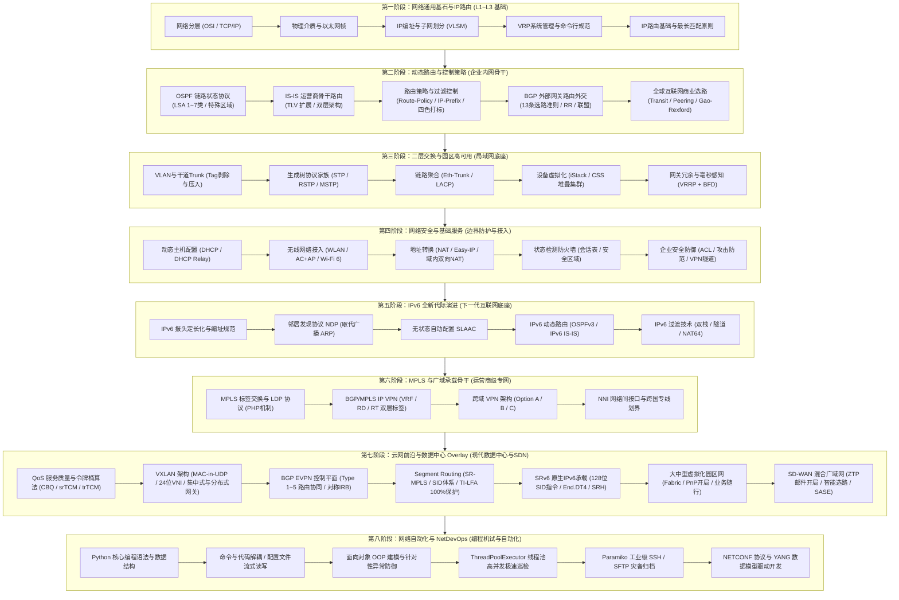

# 《数通工程师全栈学习笔记》总览与知识地图

> **核心哲学**：从物理比特到原生 IPv6 算网一体化，以“协议第一性原理”穿透网络黑盒。  
> **整理定位**：面向数通网络工程师、企业网架构师、HCIP/HCIE 备考冲刺者与 NetDevOps 开发者的**全景实战知识体系（Datacom Bible）**。

---

## 一、 数通工程师全生命周期技术拓扑全景图

数通网络不是零碎命令行的拼凑，而是一张层层递进、环环相扣的精密网格。从终端网卡发出一个数据帧，到穿透大二层、打通广域骨干并抵达云端，网络技术贯穿始终：



---

## 二、 核心理论体系：数通工程师的“三大底层心法”

网络技术虽然协议繁多，但其底层始终遵循三大第一性原理：

```
                ┌────────────────────────────────────────────────────────┐
                │             数通工程师三大第一性原理心法                │
                └──────────────────────────┬─────────────────────────────┘
                                           │
         ┌─────────────────────────────────┼─────────────────────────────────┐
         ▼                                 ▼                                 ▼
【心法一: 报文封装与控制解耦】   【心法二: 路由双向与对称闭环】   【心法三: 模型驱动与自动化交付】
- 数据在发送端逐层压栈包装        - 报文能过去，不代表能回来！     - 摒弃面向肉眼的脆弱 CLI
- 链路层查 MAC，网络层查 IP       - 必须时刻追踪去程路由与回程路由 - 全面拥抱结构化模型 (YANG)
- 控制平面指路，转发平面跑包      - 防火墙与 NAT 必须严格双向对称  - 事务化、可编程、毫秒级批量自愈
```

| 心法维度 | 核心本质与底层逻辑 | 现网排错警句 |
|:---|:---|:---|
| **1. 报文封装与控制解耦** | 数据通信的本质是“层层封装与解封装”。二层交换机只看 DMAC，三层路由器只看 DIP，Overlay 只看外层 UDP 4789，标签栈只看栈顶 20 位。控制平面（OSPF/BGP/EVPN）负责算路，转发平面（FIB/TCAM）负责线速冲刺。 | “抓包是网络工程师唯一的真理！不要猜配置，抓出报文一层一层剥开看，故障无所遁形。” |
| **2. 路由双向与对称闭环** | 网络通信是双向的会话过程（Ping 有 Request 必有 Reply，TCP 有 SYN 必有 ACK）。单向通不代表网络通；状态检测防火墙、NAT 转换以及策略路由极易引发回包路径不一致导致连接静默重置。 | “配完去程路由，必须立刻脑补回程路由！排查网络不通，50% 的原因在于回程路由丢失或不对称绕行。” |
| **3. 模型驱动与可编程演进** | 传统网络依靠工程师手工敲命令行屏幕抓取（Screen Scraping），脆弱且无事务保障；新一代网络依靠 NETCONF/YANG、SRv6 与 SD-WAN，网络即代码（Infrastructure as Code）。 | “不要做只会敲 display 的人肉巡检工！让机器用结构化语言同设备对话，让代码替你守护全网高可用。” |

---

## 三、 全书十篇结构全景导航

全书由 **35 卷标准技术分卷**、**4 份企业级系统 PRD** 与 **4 份实战军火库附录** 构筑起超过 53 万字的宏大知识图谱：

### 01 第一篇：数通网络通用基石（第 01 ~ 04 卷）
* [卷01：网络基础与网络参考模型](01_第一篇_数通网络通用基石/01-网络基础与网络参考模型.md) —— OSI 七层、TCP/IP 四层、物理介质与以太网数据链路层基础
* [卷02：VRP系统与设备管理](01_第一篇_数通网络通用基石/02-VRP系统与设备管理.md) —— 华为 VRP 操作系统架构、命令行视图规范、配置文件与文件系统维护
* [卷03：网络层协议与IP编址](01_第一篇_数通网络通用基石/03-网络层协议与IP编址.md) —— IPv4 报头、子网划分 VLSM、ICMP 机制与 ARP 协议
* [卷04：IP路由基础](01_第一篇_数通网络通用基石/04-IP路由基础.md) —— 路由表寻址、最长匹配原则、静态路由与浮动静态路由容灾

### 02 第二篇：动态路由与控制策略（第 05 ~ 10 卷）
* [卷05：OSPF路由协议](02_第二篇_动态路由与控制策略/05-OSPF路由协议.md) —— 链路状态算法、八大状态机、1~7 类 LSA 全貌与四大特殊区域
* [卷06：IS-IS路由协议](02_第二篇_动态路由与控制策略/06-IS-IS路由协议.md) —— 运营商骨干网路由首选、TLV 扩展架构、Level-1/2 区域设计与 DIS 机制
* [卷07：路由策略与路由控制](02_第二篇_动态路由与控制策略/07-路由策略与路由控制.md) —— Route-Policy、IP-Prefix、双向重分发防环四色打标法与 PBR 策略路由
* [卷08：BGP基础与路径优选](02_第二篇_动态路由与控制策略/08-BGP基础与路径优选.md) —— 路径矢量协议、13 条选路准则、RR 路由反射器与 Transit/Peering 商业流量模型
* [卷09：BGP高级特性](02_第二篇_动态路由与控制策略/09-BGP高级特性.md) —— 路由聚合（Atomic/Aggregator）、BGP 团体属性应用、ORF 与安全加固
* [卷10：IGP高级特性](02_第二篇_动态路由与控制策略/10-IGP高级特性.md) —— OSPF/IS-IS 快速收敛（I-SPF/PRC）、LFA 快速重路由与安全认证机制

### 03 第三篇：二层交换与园区高可用（第 11 ~ 14 卷）
* [卷11：VLAN、VLAN间通信与ACL](03_第三篇_二层交换与园区高可用/11-VLAN、VLAN间通信与ACL.md) —— Access/Trunk/Hybrid 端口 Tag 处理、单臂路由与三层交换、ACL 分类
* [卷12：生成树协议家族](03_第三篇_二层交换与园区高可用/12-生成树协议家族.md) —— STP/RSTP/MSTP 破环机制、P/A 快速协商与多实例负载分担
* [卷13：链路聚合与设备堆叠](03_第三篇_二层交换与园区高可用/13-链路聚合与设备堆叠.md) —— LACP 链路聚合、iStack 交换机堆叠与 CSS 集群免 STP 架构
* [卷14：VRRP与BFD](03_第三篇_二层交换与园区高可用/14-VRRP与BFD.md) —— 网关冗余备份、VRRP 状态机与 BFD 毫秒级故障联动

### 04 第四篇：基础网络服务与安全（第 15 ~ 18 卷）
* [卷15：DHCP与无线接入](04_第四篇_基础网络服务与安全/15-DHCP与无线接入.md) —— DHCP 工作原理与中继、WLAN 基础、AC+AP 组网与 Wi-Fi 6 特性
* [卷16：NAT与PPP](04_第四篇_基础网络服务与安全/16-NAT与PPP.md) —— 静态/动态 NAT、NAPT、Easy-IP、NAT Server 端口映射与广域网 PPP 协议
* [卷17：防火墙与VRF](04_第四篇_基础网络服务与安全/17-防火墙与VRF.md) —— 状态检测防火墙安全区域、会话表生成、VRF 虚拟路由转发与多租户切片
* [卷18：网络安全技术](04_第四篇_基础网络服务与安全/18-网络安全技术.md) —— 端口安全、ARP 欺骗防范、DHCP Snooping、IPsec 加密与零信任/SASE 演进

### 05 第五篇：IPv6 新一代演进（第 19 ~ 21 卷）
* [卷19：IPv6基础与编址](05_第五篇_IPv6新一代演进/19-IPv6基础与编址.md) —— IPv6 报头定长化、128 位地址结构、NDP 邻居发现与 SLAAC 自动配置
* [卷20：IPv6路由协议](05_第五篇_IPv6新一代演进/20-IPv6路由协议.md) —— OSPFv3 机制、IPv6 IS-IS 多拓扑扩展与 BGP4+ 协议
* [卷21：IPv6过渡技术](05_第五篇_IPv6新一代演进/21-IPv6过渡技术.md) —— 双栈技术（Dual-Stack）、IPv6 隧道技术与 NAT64 协议转换

### 06 第六篇：MPLS 与承载骨干（第 22 ~ 24 卷）
* [卷22：MPLS原理与LDP](06_第六篇_MPLS与承载骨干/22-MPLS原理与LDP.md) —— 标签交换原理、32位标签头、PHP 次末跳弹出与 LDP 邻居分发
* [卷23：MPLS L3VPN原理与部署](06_第六篇_MPLS与承载骨干/23-MPLS-L3VPN原理与部署.md) —— VRF、RD、RT 体系、MP-BGP 分发私网标签与双层标签数据转发
* [卷24：MPLS VPN跨域](06_第六篇_MPLS与承载骨干/24-MPLS-VPN跨域.md) —— Option A 背靠背、Option B 单跳 MP-EBGP、Option C 端到端与 NNI 接口规范

### 07 第七篇：云网前沿与高级特性（第 25 ~ 32 卷）
* [卷25：QoS服务质量](07_第七篇_云网前沿与高级特性/25-QoS服务质量.md) —— 队列调度（PQ/WRR/CBQ）、WRED 随机丢弃防 TCP 同步、CAR 监管与 GTS 令牌桶
* [卷26：VXLAN技术](07_第七篇_云网前沿与高级特性/26-VXLAN技术.md) —— 大二层困境破除、MAC-in-UDP 50 字节封装、集中式与分布式网关模型
* [卷27：EVPN原理与配置](07_第七篇_云网前沿与高级特性/27-EVPN原理与配置.md) —— MP-BGP EVPN 控制平面、Type 1~5 路由协同、水平分割防环与对称 IRB
* [卷28：Segment Routing](07_第七篇_云网前沿与高级特性/28-Segment-Routing.md) —— 源路由理念、Prefix/Node/Adj-SID 体系、SRGB 标签计算与 TI-LFA 100% 保护
* [卷29：SRv6原理与配置](07_第七篇_云网前沿与高级特性/29-SRv6原理与配置.md) —— 原生 IPv6 承载、128位 SID 指令集（End/End.X/End.DT4）、SRH 扩展头
* [卷30：企业园区网全景与业务随行](07_第七篇_云网前沿与高级特性/30-企业园区网全景与业务随行.md) —— 分层架构设计、准入三剑客、业务随行（安全组/策略矩阵/VXLAN直传）
* [卷31：大中型虚拟化园区网设计](07_第七篇_云网前沿与高级特性/31-大中型虚拟化园区网设计.md) —— Fabric 架构、Border/Edge 节点矩阵、Underlay PnP 自动化开局与多 VN 切片
* [卷32：SD-WAN解决方案](07_第七篇_云网前沿与高级特性/32-SD-WAN解决方案.md) —— Hybrid WAN 混合链路降本增效、ZTP 邮件开局、DPI 应用识别与 SLA 智能选路

### 08 第八篇：网络自动化与机试（第 33 ~ 35 卷）
* [卷33：Python编程基础](08_第八篇_网络自动化与机试/33-Python编程基础.md) —— Python 核心语法、数通文本清洗、`with open` 命令解耦与 `*args/**kwargs` 解包
* [卷34：Python面向对象与进阶](08_第八篇_网络自动化与机试/34-Python面向对象与进阶.md) —— 类与对象封装、针对性异常防御处理、`ThreadPoolExecutor` 线程池高并发巡检
* [卷35：Python网络自动化](08_第八篇_网络自动化与机试/35-Python网络自动化.md) —— Paramiko SSH/SFTP 定时备份、NETCONF/YANG 驱动开发、HCIE Datacom 编程机试大题全景通关

### 09 第九篇：系统级 PRD 工程设计（4 份系统规范）
* [数通工程师全栈学习笔记体系 PRD](09_第九篇_系统级PRD工程设计/数通工程师全栈学习笔记体系_PRD.md) —— 本全栈知识体系的整体设计规格说明书与编纂指导
* [SD-WAN 企业分支互联解决方案 PRD](09_第九篇_系统级PRD工程设计/SD-WAN企业分支互联解决方案_PRD.md) —— 企业级 SD-WAN 混合链路改造项目需求说明书
* [企业园区网自动化运维脚本系统 PRD](09_第九篇_系统级PRD工程设计/企业园区网自动化运维脚本系统_PRD.md) —— Python 网络自动化巡检与 24 小时灾备归档系统 PRD
* [大中型虚拟化园区网络架构设计 PRD](09_第九篇_系统级PRD工程设计/大中型虚拟化园区网络架构设计_PRD.md) —— 华为 CloudCampus 虚拟化 Fabric 组网与业务随行 PRD

### 10 第十篇：附录与数通实战军火库（4 份高价值附录）
* [附录A：数通高频核心 100 问与面试突击宝典](10_第十篇_附录与数通实战军火库/附录A_数通高频核心100问与面试突击宝典.md) —— 覆盖高频面试与生产排错全场景的技术速查字典
* [附录B：组播技术深度解析（IGMP与PIM）](10_第十篇_附录与数通实战军火库/附录B_组播技术深度解析_IGMP与PIM.md) —— 组播地址映射、IGMPv1/v2/v3 演进与 PIM-SM 汇聚点切换
* [附录C：全球广域网互联与前沿专题（Transit/Peering/NNI/SASE）](10_第十篇_附录与数通实战军火库/附录C_全球广域网互联与前沿专题_Transit_Peering_NNI_SASE.md) —— 互联网商业互联模型、NNI 标准接口与 SASE 云安全架构
* [附录D：华为云网融合与算力网络前沿实战（IPv6+/SRv6/无损以太/CU分离）](10_第十篇_附录与数通实战军火库/附录D_华为云网融合与算力网络前沿实战_IPv6Plus_SRv6_无损以太_CU转控分离.md) —— 算网大脑、东数西算、AIDC 无损以太网（RoCE/SPFC/AFR）、IPv6+（APN6/IFIT/SFC）、TI-LFA 100% 收敛与 vBNG CU 转控分离

---
*（建议将本总览文档作为知识库的第一入口，配合 Mermaid 拓扑图建立宏观技术坐标系）*
