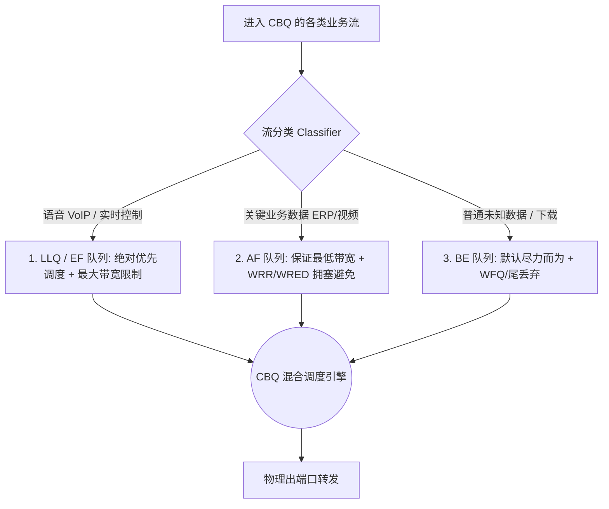
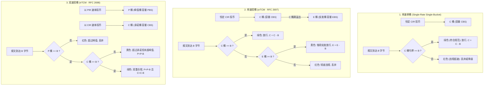

# 第25章 QoS 服务质量与流量管理

> 网络带宽有限时的交通调度艺术：QoS 从“治标不治本”的哲学定位出发，详解三种服务模型（Best-Effort / IntServ / DiffServ）与报文标记体系（CoS / EXP / ToS / DSCP）；深入拥塞管理队列演进（从传统 PQ/WRR/WFQ 到量化带宽的 CBQ 与多租户 HQoS）、拥塞避免（防 TCP 全局同步的 WRED）；压轴剖析流量监管（CAR）与流量整形（GTS）的令牌桶算法（单速双桶 srTCM / 双速双桶 trTCM）——让关键业务在拥塞风暴中稳如泰山。

| 项 | 内容 |
|---|---|
| **适用层级** | HCIE 核心高级特性（面试高频提问、实验配置必备、架构设计必考） |
| **建议学习位次** | 全书第 25 章，先修第 03 章（ToS/分片）、第 07 章（MQC 架构）、第 11 章（802.1Q CoS）、第 22 章（MPLS EXP）；本章是进入数据中心与广域网精细化运维的门槛 |
| **技术维度** | 协议原理深度剖析 · 生产级VRP配置 · 故障诊断排错 · 架构设计决策 |

---

## 一、总起

网络技术发展至今，物理链路带宽不断翻倍，但流量的爆发式增长使得拥塞依然无处不在。当多路流量汇聚到低速出口时，排队时延拉长、抖动加剧、无差别丢包，导致关键业务瘫痪。QoS（Quality of Service，服务质量）正是解决这一矛盾的核心武器。

首先必须确立 QoS 的根本定位：**QoS 是一种“治标不治本”的资源调配与优化技术**。它无法凭空增加物理带宽，而是在带宽发生瓶颈时，通过“差别化对待”，牺牲非关键流量（如下载、文件传输）的体验，优先保全高价值、低时延业务（如语音、视频会议、金融交易）。

本章从以下核心维度构建了端到端的 DiffServ（区分服务）架构落地闭环：
1. **服务模型与标记**：比较三种服务模型，详解 802.1Q（CoS）、MPLS（EXP）以及 IPv4/IPv6（ToS/DSCP）的标记编码，确立“网络边界做复杂分类与重标记，网络核心做简单分类与高速调度”的信任边界设计法则；
2. **拥塞管理**：从传统队列（FIFO、PQ、WRR、DRR、WFQ）的机制缺陷，演进到支持量化带宽保证与低时延专线的 **CBQ（Class-Based Queuing）**，再到面向多租户云网的多级调度 **HQoS**；
3. **拥塞避免**：剖析传统尾丢弃（Tail-Drop）引发的“TCP 全局同步”与饿死震荡，详解 WRED 如何利用早期随机丢弃实现流量平滑削峰；
4. **限速与令牌桶**：厘清流量监管（CAR，双向限速直接丢弃）与流量整形（GTS，出向限速削峰填谷）的本质差异，彻底拆解单速单桶、单速双桶（srTCM）与双速双桶（trTCM）的数学逻辑与红黄绿着色判定。

**适用人群**：
- **初学 / 转行人员（HCIP 进阶）**：建立时延、抖动、丢包与带宽的立体认知，搞懂语音、视频与数据业务的流量画像及 DSCP 常见数值；
- **备考工程师（HCIE 核心攻坚）**：攻克 CBQ 四大队列类型（LLQ/EF/AF/BE）的调度次序、WRED 随机早期检测与 TCP 全局同步、单速双桶 vs 双速双桶参数计算（CIR/PIR/CBS/PBS）、以及 MQC QoS 综合实验配置；
- **一线工程实践者**：掌握大型企业与金融专线出入口带宽控制、音视频会议质量卡顿调优、多业务 QoS 映射矩阵设计、以及防范租户流量滥用的安全监管模板。

### 本章技术架构与核心脉络

| 模块序号 | 核心技术议题 | 架构要点与设计精髓 |
|:---|:---|:---|
| **§25.1** | QoS服务模型1 | QoS本质定位、四业务需求画像、四种时延与排队发力点、三服务模型（Best-Effort/IntServ/DiffServ）、CoS/EXP/ToS/DSCP编码与映射 |
| **§25.2** | QoS报文分类和标记 | 简单流分类 vs 复杂流分类、信任边界与 Remark 重标记、拥塞管理传统队列（FIFO/PQ/WRR/DRR/WFQ/PQ+WFQ 混合） |
| **§25.1** | QoS队列技术 | 传统队列缺陷、CBQ 队列四组件（LLQ/EF/AF/BE）、尾丢弃三大弊端、WRED 早期随机丢弃、HQoS 三级队列分层调度 |
| **§25.2** | 流量整形和流量监管 | 监管（CAR，入/出无缓存） vs 整形（GTS，出向削峰填谷）、令牌桶原理（单速单桶/单速双桶/双速双桶）、红黄绿着色算法、VRP 配置实战 |

---

## 二、分述

### 2.1 QoS 本质定位与三种服务模型

#### 核心原理与业务画像

【设计本源与技术哲学】：“QoS 是一种治标不治本的网络优化技术，它不是用来解决带宽不够用的问题的，它是没办法从根本上解决带宽不够用的问题的。带宽不够最根本的办法是加钱拉专线、扩带宽。”

QoS 的作用是在**拥塞发生时，有差别地分配有限的带宽资源**。网络质量受四大核心指标制约：
- **带宽（Bandwidth）**：单位时间内传输的最大数据量；
- **时延（Delay）**：数据包从源端到达目的端所需的时间，由四部分组成：
  $$\text{总时延} = \text{处理时延} + \text{排队时延} + \text{串行化（传输）时延} + \text{传播时延}$$
  其中传播时延由光速和物理距离决定，处理时延取决于芯片性能，**QoS 唯一能够优化和改变的只有“排队时延”**；
- **抖动（Jitter）**：相邻数据包到达时延的变化幅度；
- **丢包率（Packet Loss）**：网络拥塞缓冲区溢出导致的数据包丢弃比例。

不同业务对网络质量的需求具有显著的差异化特征：

| 业务类型 | 带宽特征 | 时延敏感度 | 丢包容忍度 | 传输协议 | 应对策略 |
|:---|:---|:---:|:---:|:---:|:---|
| **语音 (VoIP)** | 固定且极低（如 G.711 每路约 64kbps） | 极高（要求 < 150ms） | 极敏感（丢包导致声音断续断句） | UDP / RTP | 给予最高优先级绝对抢占（LLQ 队列） |
| **交互视频 / 会议** | 较高且较稳定（2Mbps ~ 10Mbps） | 高（要求 < 200ms） | 敏感（出现马赛克与音画不同步） | UDP / RTP | 给予保证带宽与受限突发保障（AF 队列） |
| **关键业务数据 (ERP/交易)** | 突发性强，带宽需求中等 | 较高 | 零容忍（丢包重传导致业务挂起） | TCP | 保证最低带宽与低丢包率，避免尾丢弃 |
| **传统数据 (FTP/下载/邮件)** | “给多少吃多少”，吞吐量无上限 | 不敏感 | 可容忍（TCP 自动可靠重传） | TCP | 尽力而为（BE 队列），拥塞时优先牺牲 |

#### 三种 QoS 服务模型对比


1. **Best-Effort（尽力而为模型）**：互联网默认模型。先进先出（FIFO），对所有报文一视同仁，没有任何 QoS 保障；
2. **IntServ（综合服务模型）**：基于 RSVP 协议，通信前沿途每一台路由器都必须为该会话硬性预留带宽和状态。缺点是：**路由器需要为每条数据流维护状态（Per-flow State），核心设备状态表项爆炸，无法在大规模网络中落地，现网已基本弃用**；
3. **DiffServ（区分服务模型）**：现代 QoS 事实标准。采用**转控分离、分而治之**的思想：
   - 在网络边缘（Access/PE）：执行**复杂流分类**，根据业务五元组识别流量并打上标记（DSCP/EXP/CoS）；
   - 在网络核心（Core/P）：只认标记不认五元组，执行**简单流分类**，根据标记直接放入对应的硬件队列进行调度，转发极快且具备高度扩展性。

---

### 2.2 报文分类与标记（Classification & Marking）

#### 二层、2.5层与三层标记字段剖析

要在网络设备间传递业务优先级，必须在报文头部打上标签。不同层级的网络协议提供了专门的优先级字段：

```
1. 二层 802.1Q 帧头 (VLAN Tag):
┌─────────────────────────┬───────┬──────┬─────────┐
│ TPID (0x8100, 16 bits)  │  PRI  │ CFI  │ VLAN ID │
└─────────────────────────┴───────┴──────┴─────────┘
                           3 bits (0~7, 称为 802.1p 或 CoS)

2. 2.5层 MPLS 标签头:
┌───────────────────────┬─────────┬──────┬─────────┐
│ Label (20 bits)       │   EXP   │  S   │   TTL   │
└───────────────────────┴─────────┴──────┴─────────┘
                         3 bits (0~7, 现称为 Traffic Class)

3. 三层 IPv4 ToS / IPv6 Traffic Class 字段:
┌─────────────────────────────────┬────────────────┐
│   DSCP (Differentiated Services)│ ECN (拥塞通知) │
└─────────────────────────────────┴────────────────┘
             6 bits (0~63)               2 bits
```

- **二层 CoS（Class of Service，802.1p）**：3 个比特，取值 0~7。仅在 Trunk 链路或带 VLAN Tag 的以太网帧中存在；
- **2.5层 MPLS EXP**：3 个比特，取值 0~7。用于 MPLS 骨干网内部传递服务等级；
- **三层 ToS 演进到 DSCP**：
  - 传统 IP 优先级（IP Precedence）：早期只使用 ToS 前 3 位（0~7），后 5 位未充分利用；
  - **DSCP（区分服务代码点）**：RFC 2474 重新定义，使用前 6 位，取值范围 0~63，共 64 个等级，后 2 位用于 ECN（显式拥塞通知）。

#### DSCP 编码体系详解（★必背标准）

DSCP 体系将 64 个值划分为四大标准类别：

| 类别名称 | DSCP 二进制 / 范围 | 常用标准值 | 对应传统 IP 优先级 | 业务应用场景 |
|:---|:---|:---:|:---:|:---|
| **CS (Class Selector)** | `xxx000` (末三位恒为 0) | CS1 ~ CS7 (8, 16, 24, 32, 40, 48, 56) | 1 ~ 7 | **向后兼容传统 IP 优先级**。其中 CS6/CS7 默认分配给网络控制协议（OSPF、BGP、LDP） |
| **EF (Expedited Forwarding)** | `101110` (十进制 **46**) | **EF = 46** | 5 | **快速加速转发**。低时延、低抖动、低丢包，专属语音报文（VoIP 载荷） |
| **AF (Assured Forwarding)** | `aaa dd 0` (4 个类 × 3 个丢弃等级) | AF11~AF13, AF21~AF23, AF31~AF33, AF41~AF43 | 1 ~ 4 | **保证转发**。带宽保障业务。第一位数字越大优先级越高；第二位数字越大拥塞时**丢弃概率越高** |
| **BE (Best Effort)** | `000000` (十进制 **0**) | **BE = 0** | 0 | **尽力而为**。普通网页浏览、文件下载、无保证流量 |

> **★ AF 矩阵记忆口诀与技巧**：
> AF 共有 4 个服务类别（Class 1~4，对应不同的带宽保证），每个类别定义了 3 级丢弃概率（Drop Precedence）：
> - AF4 类优于 AF3 类，AF3 优于 AF2，AF2 优于 AF1；
> - 在同一个类中（例如 AF4）：**AF41（低丢弃率，最不易丢） < AF42（中丢弃率） < AF43（高丢弃率，拥塞时最先丢）**；
> - 助记：数字越小越安全，十位数比高低，个位数比弃权！

#### 简单流分类 vs 复杂流分类与信任边界

1. **简单流分类（Simple Classification）**：直接根据报文自带的外部标记（CoS、DSCP、EXP）映射到设备内部的**服务等级（Service-Class）和丢弃颜色（Color）**。配置简单，不耗费 CPU 深度检测能力；
2. **复杂流分类（Complex Classification）**：不再局限于优先级标记，而是通过 ACL 深度匹配五元组（源目 IP、源目端口、协议号）乃至报文特征（如 TCP SYN 报文、报文长度）进行多维度细粒度归类；
3. **信任边界（Trust Boundary）**：
   - 终端设备（PC、手机）自身打上的 DSCP/CoS 不可信（用户可能恶意篡改以获取特权）；
   - 在企业网接入交换机或运营商边界路由器上，必须设定**信任边界**：
     - 若 `trust dscp / trust 8021p`：信任下游特定设备（如企业 IP 电话通过 CDP/LLDP 协商受信任）；
     - 若不信任：将所有外部流量重置为 BE（0），并在边界根据复杂流分类执行 **Remark（重标记）**。

---

### 2.3 拥塞管理传统队列（Congestion Management）

当端口发生拥塞（物理出方向发包速率大于链路承载能力）时，报文必须在硬件缓冲区排队。**队列算法决定了报文出队的先后次序与带宽权重**。

```
报文到达 ──> [ 分流机制 ] ──┬──> [ 队列 7 (高优先级) ] ──> ┌─────────────┐
                           ├──> [ 队列 6              ] ──> │             │
                           │    ...                        │ 调度调度器  │ ──> 出接口线速转发
                           └──> [ 队列 0 (低优先级) ] ──> │ (Scheduler) │
                                                           └─────────────┘
```

#### 传统五大基础队列深度对比

| 队列算法 | 全称 | 调度机制与特点 | 优势 | 致命缺陷与局限性 |
|:---|:---|:---|:---|:---|
| **FIFO** | First In First Out | 单一硬件队列，报文按到达顺序先后转发 | 算法最简，零 CPU 消耗，无乱序 | 无法区分业务，关键语音报文被大包阻断造成巨大抖动 |
| **PQ** | Priority Queuing | 绝对优先级队列（分为 Top/Middle/Normal/Bottom 或 8 个严格等级）。**只有高优先级队列完全排空，才轮到低优先级发送** | 能够为语音等低时延业务提供绝对硬性实时保障 | **低优先级队列面临“饿死”（Starvation）风险**；高优先级流量一旦异常泛洪，整网业务全部被阻断 |
| **RR** | Round Robin | 轮询队列。各队列按固定顺序轮流发送一个报文 | 杜绝饿死，各队列轮询机会均等 | 忽略报文长度（大包占便宜，小包吃亏），无法按带宽比例精细分配 |
| **WRR** | Weighted Round Robin | 加权轮询。为每个队列赋予权重值（如 4:2:1），按权重轮流发送报文包数 | 避免饿死，支持按队列赋予不同服务倾斜 | 依然基于“报文个数”而非“字节数”加权，实际带宽占比随数据包大小动态失真 |
| **DRR** | Deficit Round Robin | 赤字轮询。引入 Deficit Counter（赤字计数器），按“字节数”进行公平轮询 | 解决 WRR 报文大小不均的问题，实现精准字节级权重轮询 | 无法提供低时延队列服务，突发流量抖动依然较大 |
| **WFQ** | Weighted Fair Queuing | 加权公平队列。自动根据五元组将流量哈希分流到多个子队列，并根据 IP 优先级动态分配带宽 | 自动分流，大流（FTP）与小流（Ping/Telnet）公平调度，小流排队短优先转发 | 依赖哈希可能发生冲突；系统自动管控，**无法满足网络管理员“指定某个业务进某个队列”的自定义需求** |

---

### 2.4 基于类的队列 CBQ 与分层 HQoS

传统队列只能依靠设备固定的 8 个队列按报文原有标记入队，无法满足工程中“某网段给 10Mbps 专线、音视频走低时延”的灵活管控需求。为此，华为引入了基于类的加权公平队列——**CBQ（Class-Based Queuing）**。

#### CBQ 内部四级队列体系

CBQ 在内部将报文分为四种不同的调度行为（PHB）：



1. **LLQ（Low Latency Queuing，低时延队列）**：
   - 机制：**PQ + 带宽限制（Policer）**；
   - 作用：专为极度敏感的实时语音（VoIP）设计。它享有绝对优先调度权（类似 PQ），但**必须为其配置最大允许带宽限制**；
   - 解决痛点：既保障了语音的零排队超低时延，又防止了高优先级语音流量泛洪导致其他所有队列彻底饿死！
2. **EF（Expedited Forwarding，快速转发队列）**：
   - 类似 LLQ，提供低时延、低抖动的绝对优先转发保证；
3. **AF（Assured Forwarding，保证转发队列）**：
   - 机制：为业务分配**保留（最低）带宽**。在接口未拥塞时可借用空闲带宽；当接口发生拥塞时，确保其获得所配置的最低带宽配额；
   - 队列内部：配合使用 WRED 丢弃机制，防止单连接 TCP 爆发；多组 AF 之间通过 WRR 权重轮询；
4. **BE（Best-Effort，尽力而为队列）**：
   - 所有未被分类命中的兜底流量自动落入 BE 队列；
   - 使用普通 WFQ 算法按 IP 优先级动态分配剩余带宽。

#### 分层 QoS（HQoS - Hierarchical QoS）

在传统网络中，QoS 只能在单一物理端口上对业务做扁平调度。但在现代多租户数据中心、政企专线、园区网中，单一物理接口（如 10GE）上汇聚了多个租户/部门：
- 需求：既要限制**每个租户的总带宽**（如租户 A 限速 100M，租户 B 限速 200M），又要在此基础上保障**租户内部不同业务的优先级**（租户 A 内部的语音优先于数据）。
- **HQoS 三级队列架构**：
  1. **第一级 Flow Queue（流队列，FQ）**：对具体业务（语音/视频/数据）做 CBQ 细化分类调度；
  2. **第二级 Subscriber Queue（用户队列，SQ）**：按租户/VLAN 进行聚合，对单个用户的总带宽做整形限制（PIR/CIR）；
  3. **第三级 Group / Port Queue（接口队列，GQ/PQ）**：对物理端口总出带宽进行全局拥塞管理。

---

### 2.5 拥塞避免机制：尾丢弃三大弊端与 WRED

#### 传统尾丢弃（Tail-Drop）的致命缺陷

当队列缓存被填满时，最简单的处理方式是将后续到达的报文直接丢弃，称为**尾丢弃（Tail-Drop）**。尾丢弃会引发三项严重的网络级灾难：

```
报文到达 ──> [ 缓冲区溢出 (Tail-Drop) ] ──> 同时丢弃全网所有 TCP 连接的数据包
                                                        │
┌───────────────────────────────────────────────────────┘
▼
1. 全局 TCP 拥塞控制触发: 全网所有 TCP 连接同时进入 Slow Start (慢启动)
2. 链路带宽利用率瞬间跌入谷底 (断崖式下跌)
3. 随后所有 TCP 连接同时线性窗口恢复，再次同时塞满队列溢出
4. 形成周期性振荡: 宽带波峰 ──> 暴跌 ──> 恢复 ──> 暴跌 (称为 TCP 全局同步!)
```

1. **TCP 全局同步（TCP Global Synchronization）**：
   - 现网绝大部分数据流基于 TCP 协议（具备窗口滑动与丢包自愈机制）。尾丢弃导致队列末尾同时丢弃来自成百上千个不同 TCP 会话的数据包；
   - 所有 TCP 发送端同时感知丢包，**同时触发拥塞避免算法，将发送窗口减半并进入慢启动**；
   - 结果导致链路带宽利用率瞬间骤降至几近于零，随后又同时逐渐加窗再次填满拥塞，产生全网周期的“惊群效应”与带宽锯齿震荡；
2. **TCP 饿死现象（TCP Starvation）**：
   - UDP 报文没有滑动窗口和拥塞控制，丢包依然疯狂狂发；
   - 当 TCP 流量与 UDP 流量混合拥塞时，TCP 遇到丢包自动避让减速，而 UDP 毫不减速继续挤占缓冲区，导致 TCP 业务被彻底压制饿死；
3. **无差别丢弃**：
   - 队列末尾的报文无论是语音控制信令还是普通下载大包，一律丢弃，关键业务首当其冲。

#### WRED（加权随机早期检测）破局之道

为解决 TCP 全局同步，IETF 提出了 RED（随机早期检测），华为在此基础上升级为 **WRED（Weighted Random Early Detection）**：

```
丢弃概率 P
  100% ┌──────────────────────────────────────────────
       │                                             / (队列达到高门限，100% 尾丢弃)
P_max  │                                           /
       │                                         /
       │                                       /
       │                                     /
   0%  └───────────────────────────┬───────/─────────> 队列平均深度
       0                       低门限   高门限       满缓冲
       │<── 绝对安全，0% 丢弃 ────>│<── 早期随机丢弃 ──>│
```

- **核心机制**：在队列尚未完全溢出之前（达到设定的低门限时），**按照概率主动随机丢弃极少量的 TCP 数据包**；
- **化解同步**：由于是随机早期丢包，同一时刻只有极少数 TCP 连接收到信号主动调小窗口避让，其余连接照常传输；不同 TCP 连接交替减速，从而将队列深度稳定在一个合理水平，彻底抚平全局同步；
- **加权机制（WRED 的“W”）**：
  - 对不同的优先级（DSCP/IP 优先级/Drop Precedence）设置不同的丢弃门限与概率：
    - 高价值报文（如 AF11）：**门限高，丢弃概率极低**；
    - 低价值报文（如 AF13）：**门限低，拥塞初期就优先被挑出来丢弃**。

---

### 2.6 流量监管（CAR）与流量整形（GTS）

在网络边界，为了防止用户滥用带宽或违反 SLA 约定，必须实施流量限速。限速技术分为两大阵营：

| 比较维度 | 流量监管 (Traffic Policing / CAR) | 流量整形 (Traffic Shaping / GTS) |
|:---|:---|:---|
| **支持方向** | **入方向（Inbound）与出方向（Outbound）均可** | **仅能在出方向（Outbound）实施** |
| **有无缓存** | **无缓存机制** | **具备内部队列缓存机制** |
| **超额处理动作** | 简单粗暴：超出约定速率的报文**立即丢弃**或降低优先级（Remark）后放行 | 削峰填谷：超出约定速率的报文**放入缓冲区排队**，待链路空闲时平滑发出 |
| **引入副作用** | 带来报文丢包，触发 TCP 重传，但**不产生额外排队时延** | **显著引入额外的排队时延与抖动**，消耗设备大量内存缓冲资源 |
| **典型应用场景** | 运营商接入层限制用户签约带宽（如“买 100M 宽带超速就丢”）；防止下级攻击 | 边缘出口路由器向运营商下游限速端口发包，平缓突发流量，防止报文被下游硬丢弃 |

【工程类比】：“流量整形就像长江三峡大坝——汛期上游洪水滔滔，大坝先在库区把水蓄起来（缓存），然后按照下游河道能够承受的平稳速率慢慢放水（出向整形），既防了洪又灌溉了下游，起到削峰填谷的作用。”

---

### 2.7 令牌桶算法原理（Token Bucket Algorithms）

无论是流量监管还是流量整形，判断报文是否超速的通用核心数学工具就是**令牌桶（Token Bucket）**。

#### 核心运行法则
- 桶内装的是**令牌（Token）**，每个令牌代表允许发送一定字节的数据（如 1 字节）；
- 系统以恒定的速率（**CIR，Committed Information Rate，承诺信息速率**）向桶中投放令牌；
- 桶具有固定的容量上限（**CBS，Committed Burst Size，承诺突发尺寸**），装满后多余的令牌溢出丢弃；
- 报文到达时需要**扣除对应报文长度的令牌**才能被放行转发；如果桶中令牌不够，则判定为违规超速。

业界根据桶的数量和投币规则，制定了三种标准模型：



#### 三大令牌桶模型深度对比

| 模型名称 | 投币速率 | 桶的配置 | 报文判定三色 | 核心应用逻辑 |
|:---|:---|:---|:---:|:---|
| **单速单桶** | 仅 CIR | 单个 C 桶（容量 CBS） | **两色**（绿 / 红） | 无法容忍突发，超出 CBS 瞬间变红丢弃，灵活性最差 |
| **单速双桶 (srTCM)** | 仅 CIR | C 桶（CBS）+ E 桶（EBS） | **三色**（绿 / 黄 / 红） | 溢出的令牌存入 E 桶。**允许偶尔突发**：平时消耗 C 桶（绿），短时突发可借用 E 桶（黄），借完则红 |
| **双速双桶 (trTCM)** | **CIR + PIR**（峰值速率） | C 桶（CBS）+ P 桶（PBS） | **三色**（绿 / 黄 / 红） | **同时监控平均速率与峰值速率**。PIR > CIR。小于 CIR 为绿，介于 CIR 与 PIR 之间为黄，超过 PIR 绝不宽恕判红 |

---

### 2.8 QoS 经典配置模板与 MQC 实战（VRP 8.x / 5.x）

华为 VRP 平台推荐通过 **MQC（模块化 QoS 命令行）** 三步法实现工业级 QoS 部署。

#### 1. 复杂流分类与 DiffServ 边界 Remark 重标记

```shell
# ═══ Step 1: 定义流分类 (Traffic Classifier) ═══
# 匹配关键语音业务 (VoIP)
acl number 3001
 rule 5 permit udp source-port eq 5060
 rule 10 permit udp destination-port eq 5060
traffic classifier TC_VOICE operator or
 if-match acl 3001

# 匹配核心办公系统与视频会议 (ERP/Video)
acl number 3002
 rule 5 permit tcp destination-port eq 443
traffic classifier TC_BUSINESS operator or
 if-match acl 3002

# ═══ Step 2: 定义流行为并执行 DSCP 打标 (Traffic Behavior) ═══
# 语音打标为最高优先级 EF (46)
traffic behavior TB_MARK_VOICE
 remark dscp ef

# 关键业务打标为 AF31 (26)
traffic behavior TB_MARK_BUSINESS
 remark dscp af31

# ═══ Step 3: 定义并绑定流策略 (Traffic Policy) ═══
traffic policy TP_INGRESS_MARK
 classifier TC_VOICE behavior TB_MARK_VOICE
 classifier TC_BUSINESS behavior TB_MARK_BUSINESS

# ═══ Step 4: 在边缘接入接口入方向应用策略 ═══
interface GigabitEthernet 0/0/1
 traffic-policy TP_INGRESS_MARK inbound
```

#### 2. 出向 CBQ 队列调度与 WRED 拥塞避免

```shell
# ═══ Step 1: 配置 WRED 丢弃模板 ═══
drop-profile WRED_PROFILE_AF3
 wred dscp
 # 对 AF31 (低丢弃): 下限 40, 上限 80, 最大丢弃率 10%
 dscp af31 low-limit 40 high-limit 80 discard-percentage 10
 # 对 AF33 (高丢弃): 下限 20, 上限 50, 最大丢弃率 50%
 dscp af33 low-limit 20 high-limit 50 discard-percentage 50

# ═══ Step 2: 定义 CBQ 队列流行为 ═══
# 语音业务进入 LLQ 队列：绝对优先，同时硬性限制带宽上限 2000 kbps (2Mbps)
traffic behavior TB_QUEUE_VOICE
 queue priority bandwidth 2000

# 关键数据业务进入 AF 队列：保证最低 10000 kbps (10Mbps) 带宽，并挂接 WRED
traffic behavior TB_QUEUE_BUSINESS
 queue af bandwidth 10000
 drop-profile WRED_PROFILE_AF3

# ═══ Step 3: 绑定流策略并在 WAN 出口出方向生效 ═══
traffic policy TP_WAN_EGRESS
 classifier TC_VOICE behavior TB_QUEUE_VOICE
 classifier TC_BUSINESS behavior TB_QUEUE_BUSINESS

interface GigabitEthernet 0/0/2
 traffic-policy TP_WAN_EGRESS outbound
```

#### 3. 流量监管 (CAR) 与流量整形 (GTS) 实例

```shell
# ═══ 场景 A: 流量监管 (CAR) —— 限制访客网络最大速率为 10Mbps ═══
traffic behavior TB_GUEST_CAR
 car cir 10240 pir 15360 cbs 1280000 pbs 1920000 green pass yellow pass red discard

# ═══ 场景 B: 接口级流量整形 (GTS) —— 出口总带宽整形为 100Mbps 削峰填谷 ═══
interface GigabitEthernet 0/0/2
 qos gts cir 100000 cbs 2500000                        # 超出 100Mbps 的流量自动在出向缓冲区排队平滑发送
```

#### 4. 状态验证与排错命令集

```shell
# 查看接口上应用的 QoS 流策略运行统计与命中包数（排错第一步）
<Huawei> display traffic-policy applied-record

# 查看特定接口的出向队列排队、丢包与 WRED 丢弃统计
<Huawei> display qos queue statistics interface GigabitEthernet 0/0/2

# 查看流量监管 (CAR) 的绿/黄/红计数器（确认是否有关键业务被错误红牌丢弃）
<Huawei> display traffic policy statistics interface GigabitEthernet 0/0/1 inbound
```

---

## 三、总结

### 核心重点十带走

1. **QoS 本质定位**：治标不治本的网络资源调配技术，物理带宽无法凭空增加，核心发力点是压低有限拥塞时的**排队时延**；
2. **三服务模型**：Best-Effort（尽力无保障）$\rightarrow$ IntServ（RSVP 逐跳预留，核心表项爆炸被淘汰）$\rightarrow$ DiffServ（边界打标、核心查标快速转发，业界事实标准）；
3. **标记编码体系**：二层 802.1Q CoS（3bit）/ 2.5层 MPLS EXP（3bit）/ 三层 IP DSCP（6bit，64个值），边界必须建立清晰的信任边界并执行 Remark；
4. **DSCP 标准分类**：CS 类兼容传统 IP 优先级；**EF（46）专属语音绝对优先**；AF 分 4 类各 3 级丢弃率（数字越小越优越不易丢）；BE（0）兜底；
5. **传统队列局限**：FIFO 无差别；PQ 绝对优先但面临**低优先级饿死风险**；WRR/DRR 轮询防饿死但缺乏硬性低时延保证；WFQ 自动哈希分流无法人工精细指定；
6. **CBQ 核心组件**：**LLQ（PQ + 强制限速）**完美兼顾语音零时延与防饿死；**AF 保证最低带宽**防抢占；**BE 尽力转发**；配合 MQC 模块化随意编排；
7. **尾丢弃三大罪状**：触发 **TCP 全局同步**产生全网带宽锯齿断崖式震荡；导致 UDP 压制 TCP 饿死；关键报文无差别丢弃；
8. **WRED 破局机制**：未满先丢，在低门限与高门限之间以设定概率**早期随机丢弃极少量 TCP 报文**，促使个别会话降速避让，彻底化解全局同步；
9. **监管 vs 整形**：CAR（监管，入/出均可，无缓存，超额直接丢弃）；GTS（整形，仅出向，有缓存，削峰填谷，引入排队时延）；
10. **令牌桶三大法则**：单速单桶（两色）；单速双桶 srTCM（利用 E 桶借用机制容忍突发，三色）；双速双桶 trTCM（以 CIR/PIR 双重速率严格监控平均与峰值，三色）。

### 落地注意事项

- **信任边界必须严防死守**：普通接入交换机面对未知终端，严禁全局默认 `trust dscp`，否则用户自发 EF 标记报文将抢光骨干网络带宽；
- **LLQ 必须配限速带宽**：在 CBQ 中配置 priority（LLQ）时，必须设定合理的带宽上限，否则语音服务器中毒泛洪将打死整个出口；
- **整形缓存与时延评估**：对时延敏感业务（VoIP）严禁经过配置了大缓冲的 GTS 接口，否则削峰填谷带来的排队时延将直接摧毁语音通话质量；
- **WRED 门限设定原则**：高门限与低门限之间应保留足够的缓冲距离（通常建议下限为队列深度的 50%，上限为 80%），距离过近将退化为尾丢弃。

### 学习建议

学习 QoS 绝不能死记命令，必须建立**“交通管制思维”**：
1. **沙盘推演**：拿一张企业出口拓扑，纸上画出“语音（64k）、视频（2M）、ERP（10M）、办公上网（100M）”同时汇聚到 50M 专线时，报文如何在各队列流转；
2. **实验实证**：在 eNSP 中搭建 Router-A 与 Router-B，中间串联 10Mbps 瓶颈链路。分别用 UDP 发包工具灌满链路，测试开启 PQ 与关闭 PQ 时 VoIP 的丢包率；开启 WRED 抓包观察 TCP 窗口的平稳滑动曲线；
3. 熟练掌握 MQC 三部曲（流分类 $\rightarrow$ 流行为 $\rightarrow$ 流策略），这是后续第 26 章~32 涉及的所有安全与 Overlay 技术通用的命令行框架。

---

## 附：本章术语速查表

| 术语缩写 | 英文全称 | 中文含义 | 关键作用 |
|---|---|---|---|
| **QoS** | Quality of Service | 服务质量 | 在网络带宽发生拥塞时，通过差异化调度保障高价值业务指标的技术体系 |
| **CoS** | Class of Service | 服务等级 | IEEE 802.1p 标准定义的以太网 VLAN 帧头 3 位优先级字段（取值 0~7） |
| **ToS** | Type of Service | 服务类型 | IPv4 头部 8 位字段，前 6 位现代被重新定义为 DSCP，后 2 位用于 ECN |
| **DSCP** | Differentiated Services CodePoint | 区分服务代码点 | IP 头部 6 位字段，定义了 64 个优先级等级（CS/EF/AF/BE）的区分服务标准 |
| **FIFO** | First In, First Out | 先进先出队列 | 最基础的单一默认队列，报文按到达顺序先后转发，无优先级区别 |
| **PQ** | Priority Queuing | 优先队列 | 严格绝对优先级调度队列，高优先级未排空前低优先级绝不发送，有饿死风险 |
| **WRR** | Weighted Round Robin | 加权轮询调度 | 为各队列赋予报文数量加权比例轮流调度，避免饿死，但受报文大小影响 |
| **WFQ** | Weighted Fair Queuing | 加权公平队列 | 自动根据五元组哈希分流，按 IP 优先级动态分配带宽，优先调度小报文 |
| **CBQ** | Class-Based Queuing | 基于类的队列 | 支持管理员自定义流分类，并提供 LLQ/EF/AF/BE 四种量化调度行为的通用队列 |
| **LLQ** | Low Latency Queuing | 低时延队列 | CBQ 中的专属优先队列，具备 PQ 的绝对优先调度权，同时受最大带宽限制防饿死 |
| **WRED** | Weighted Random Early Detection | 加权随机早期检测 | 拥塞避免机制，在队列未满时按概率主动丢弃极少 TCP 报文，根治 TCP 全局同步 |
| **CAR** | Committed Access Rate | 承诺访问速率 | 流量监管技术，利用令牌桶评估速率，入/出双向均可部署，超出速率直接丢弃 |
| **GTS** | Generic Traffic Shaping | 通用流量整形 | 流量整形技术，出向将超额流量放入队列缓存削峰填谷，平缓突发但引入时延 |
| **CIR** | Committed Information Rate | 承诺信息速率 | 令牌桶向桶内注入令牌的平均约定速率（单位通常为 kbps 或 bps） |
| **CBS** | Committed Burst Size | 承诺突发尺寸 | 令牌桶 C 桶的容量上限，决定了允许突发通过的最大连续数据量 |
| **srTCM** | Single Rate Three Color Marker | 单速三色标记器 | RFC 2697 标准单速双桶算法，以单一 CIR 投币，区分绿/黄/红三色流量 |
| **trTCM** | Two Rate Three Color Marker | 双速三色标记器 | RFC 2698 标准双速双桶算法，以 CIR 与 PIR 独立双速投币，严格限制峰值 |
| **HQoS** | Hierarchical Quality of Service | 分层服务质量 | 具备流队列、用户队列与接口队列三级分层调度能力的云网多租户 QoS 架构 |
