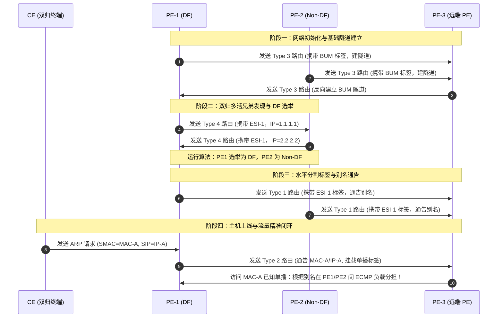

# 第27章 EVPN原理与配置

> 云网大一统控制平面：从 VPLS 二层 VPN 的“单活阻塞”与“泛洪学表”痛点切入，深度剖析 BGP EVPN（AFI 25 / SAFI 70）的划时代革新；全面拆解 EVPN 核心对象（ES / ESI / EVI / DF）与三大私网标签（ESI / BUM / 单播标签）；全网首度系统复原 Type 1~Type 5 五类 NLRI 路由的生成时序（3→4→1→2→5）与精密协作；攻克双归多活（All-Active）下的水平分割防环、别名负载分担、Massive 快速收敛与对称 IRB 分布式网关；提供生产级单域二层/三层配置模板与状态诊断矩阵。

| 项 | 内容 |
|---|---|
| **适用层级** | HCIE 殿堂级核心控制协议（面试压轴必考、云网一体化与新一代数据中心绝对基石） |
| **建议学习位次** | 全书第 27 章，先修第 08 章/09（BGP 属性与反射器）、第 22 章/23（MPLS 标签体系与 L3VPN）、第 26 章（VXLAN 数据平面）；学完本章后建议后修第 28 章/29（Segment Routing 与 SRv6） |
| **技术维度** | 协议原理深度剖析 · 生产级VRP配置 · 故障诊断排错 · 架构设计决策 |

---

## 一、总起

在数据中心大二层和广域网二层互联的历史演进中，传统技术经历了从 VPLS（Virtual Private LAN Service）到 EVPN（Ethernet VPN）的跨越。VPLS 虽然实现了跨 IP/MPLS 网络的局域网仿真，但在大规模现代云数据中心中暴露出三大致命瓶颈：
1. **控制面缺失，依赖数据面泛洪学习**：VPLS 本质上就是一台“虚拟大透明网桥”，完全依赖未知单播和广播的泛洪来学习 MAC 地址。当网络规模扩大时，广播风暴和 MAC 震荡无法遏制；
2. **无法原生支持多活负载分担（All-Active）**：为了防止二层环路，VPLS 在多归属（Multi-Homing）接入时只能采用“主备（Active-Standby）”模式，强行阻塞备用链路，导致昂贵的广域网/数据中心带宽有 50% 处于常年闲置；
3. **故障收敛极其缓慢**：当一个站点的接入链路中断时，PE 设备必须向全网 PE 逐条通告撤销该站点成千上万个主机的 MAC 地址，在超大规格租户环境下收敛时延高达数秒乃至数十秒。

**EVPN（RFC 7432）** 应运而生。它将 BGP 这一互联网最强壮、扩展性最好的路由协议引入二层网络，扩展出 **L2VPN EVPN 地址族（AFI=25, SAFI=70）**。通过将 MAC 地址、主机 IP 以及网段路由抽象为 BGP NLRI（网络层可达信息），EVPN 将原本依赖数据面泛洪的 MAC 学习彻底升级为**控制平面路由交互**！

本章从以下核心维度构建了从“协议原理到双归多活与实验落地”的完整闭环：
1. **VN 架构理念与协议演进**：对比 VPLS 与 EVPN 的本质优劣，确立 EVPN 在园区网（VXLAN 控制面）、数据中心（Spine-Leaf Fabric）、广域网（DCI 跨域互联）、SD-WAN 以及新一代 SR-MPLS / SRv6 中的“**大一统控制平面**”垄断地位；
2. **术语体系与三大私网标签**：系统推导 ES（以太网段）、ESI（10 字节段标识）、EVI（EVPN 实例）、DF（指定转发器）的数学与逻辑定义；剖析 ESI 标签（水平分割防环）、BUM 标签（广播泛洪组网）、单播标签（已知单播直达）的分工；
3. **五类核心路由（NLRI Type 1~5）协同推演**：详解 Type 1（自动发现）、Type 2（MAC/IP 发布）、Type 3（集成组播）、Type 4（网段发现与 DF 选举）、Type 5（IP 前缀路由）的报文结构与精密时序（3 $\rightarrow$ 4 $\rightarrow$ 1 $\rightarrow$ 2）；
4. **双归多活高阶机制**：全面揭秘基于 ESI 标签的水平分割防环、基于 Type 1 的别名（Aliasing）多路径负载均衡、以及单条 Type 1 批量撤销实现“毫秒级快速收敛”；
5. **VRP 配置与业务模式实践**：基于华为 VRP 系统完成单域二层 EVPN（同子网互通）、二三层混跑、分布式对称网关（Symmetric IRB）部署与验证。

**适用人群**：
- **初学 / 转行人员**：理解为什么现代网络不再靠“二层广播学 MAC”，建立控制平面分发 MAC/IP 的高级思维；
- **备考工程师（HCIE 核心攻坚）**：彻底拿下 HCIE 面试中最高频的“EVPN 5类路由详细字段与产生顺序”、“双归场景下防环与 DF 选举”、“Type 1 路由两大细分（EAD per ES vs EAD per EVI）的作用”；
- **一线工程实践者**：掌握数据中心 Spine-Leaf 自动化架构控制面配置、企业跨站点 L2/L3 互通配置规范、双归接入 E-Trunk/M-LAG 联动排错。

### 本章技术架构与核心脉络

| 模块序号 | 核心技术议题 | 架构要点与设计精髓 |
|:---|:---|:---|
| **§27.1** | EVPN原理与配置1 | VN虚拟网络理念、Fabric即服务、VPLS原理与弊端(无控制面/双活受限)、业务随行6大方案、防火墙旁挂/直连出口设计、EVPN大一统定位 |
| **§27.2** | EVPN原理与配置2 | ES/ESI/EVI/Mark VRF/DF基础术语、三大私网标签(ESI/BUM/单播)、路由类型1~4及产生时序(3→4→1→2)、BUM头端复制+DF防环、水平分割、Aliasing别名、秒级快速收敛 |
| **§27.3** | EVPN原理与配置3 | 单域二层EVPN实验(VLAN10/20同子网互访)、BGP EVPN邻居/反射器配置、抓包验证BUM与单播标签流转、四种接入模式(Port/VLAN/Bundle/BD)、二三层混跑与跨域Option A/B/C |

---

## 二、分述

### 2.1 传统 VPLS 瓶颈与 EVPN 的历史定位

#### VPLS vs EVPN 对比矩阵

| 评估维度 | 传统 VPLS (Virtual Private LAN Service) | 新一代 BGP EVPN (RFC 7432) |
|:---|:---|:---|
| **控制平面** | **无控制面**（仅使用 LDP 或 BGP 建立 PW 伪线，MAC 地址完全不在控制面交互） | **强控制面**（使用 MP-BGP EVPN 地址族通告 MAC、IP、网段及拓扑信息） |
| **MAC 学习方式** | 数据平面**未知单播/广播泛洪学习**，消耗海量网络带宽 | **控制平面 BGP 路由交互**，由本地 PE 捕获后作为路由主动通告全网 |
| **接入冗余性** | **只能主备（Active-Standby）**，备用链路必须阻塞以防环，带宽浪费 50% | **天然原生双活 / 多活（All-Active）**，多条上行链路同时转发流量并做负载分担 |
| **故障收敛性能** | 慢（站点下线需全网逐条刷新或全网清空 MAC 表重新泛洪学习） | **毫秒级收敛**（撤销一条 Type 1 路由即可瞬间使全网对应站点的所有 MAC 失效） |
| **跨网段三层能力** | 纯二层管道，需挂接外部物理路由器或复杂单臂路由 | **原生支持分布式网关（IRB）**，二层桥接与三层路由在同一控制平面内闭环 |
| **防环机制** | 依赖全连接伪线（Full-Mesh PW）和水平分割，双归接入依赖 STP/E-Trunk 阻塞端口 | 依赖 **ESI 标签水平分割**与 **DF（指定转发器）**机制，全链路转发不阻断物理端口 |

#### 传统 VPLS 面临的四大核心挑战与 EVPN 破局机制

在大型运营商城域网与数据中心实践中，VPLS 暴露出了四大深层痛点，而 EVPN 则通过引入 BGP 控制面实现了维度压制：

1. **流量不均（双归单活） $\to$ EVPN 原生双归双活**：
   - **VPLS 痛点**：二层环路天性导致双归属 CE 接入时，备用 PE 端口必须被阻塞（如 STP/Smart-Link），导致 50% 链路带宽长年闲置；
   - **EVPN 破局**：引入 **ESI（以太网段标识）**，双归 PE 虚拟为同一 ES 实体，天然支持多路径 ECMP 等价负载分担。
2. **故障收敛极其缓慢 $\to$ EVPN 亚秒级快速收敛**：
   - **VPLS 痛点**：CE 链路断开后，必须向全网下发 LDP 撤销 MAC 报文，对端 PE 清空本地所有关联 MAC 并重新广播泛洪学习，耗时高达 5~10 秒；
   - **EVPN 破局**：本地 PE 仅需向反射器发送一条 BGP 撤销 **Type-1 路由（Auto-Discovery per ES）**，远端 PE 瞬间将下一跳从当前失效 PE 批量剔除，收敛进入 **500ms 亚秒级**。
3. **ARP 泛洪严重 $\to$ EVPN ARP 广播抑制（ARP 代答）**：
   - **VPLS 痛点**：任何 CE 主机广播的 ARP Request 都会被无脑复制并泛洪到全网所有 PE 和远端 CE，广播风暴风险极大；
   - **EVPN 破局**：PE 依靠 Type-2 路由预先学习并缓存了全网主机的 IP-MAC 绑定表；当本地收到 ARP 请求时，**PE 本地直接代答 ARP Reply**，从源头阻断泛洪流入骨干。
4. **PW 全连接导致扩展性恶化 $\to$ EVPN 路由反射器极简拓扑**：
   - **VPLS 痛点**：为防环禁止 PW 间互相转发，任意两台 PE 之间必须建立直连 PW，连接数随节点数 $ 呈 $\frac{N(N-1)}{2}$ 指数级爆炸；
   - **EVPN 破局**：引入 BGP 路由反射器（RR），PE 仅需与核心 RR 建立单跳 BGP 邻居，连接复杂度降至 (N)$，且一套协议同时统一承载 L2VPWS、L2VPLS 与 L3VPN。

【设计本源与技术哲学】：“EVPN 是目前数通领域必须要学好的绝对核心协议！现在的园区网（VXLAN 控制面）、数据中心、广域网二三层 VPN、SD-WAN，乃至后面的 Segment Routing 和 SRv6，全部统一用 EVPN 作为控制平面。只要你把 EVPN 搞懂了，后面所有新技术在控制面上都是一通百通！”

---

### 2.2 核心术语与三大私网标签体系

在 EVPN 网络中，PE 节点之间不仅交互 IP 路由，还交互二层拓扑与转发表项。以下概念是构建 EVPN 思维的基石：

```
       [CE1 (双归属接入)]
        /              \
  (ES1 / ESI-1)   (ES1 / ESI-1)
      /                  \
   [PE1] ══════════════ [PE2] (兄弟 PE 节点，跑 BGP EVPN)
     \                    /
      \                  /
       ═══════ [PE3] ════
                 |
               [CE2]
```

1. **ES（Ethernet Segment，以太网段）**：连接同一个 CE 与多个 PE 设备的一组链路集合。如果 CE 仅单归到一台 PE，该链路即为一个单独的 ES；如果 CE 双归到 PE1 和 PE2，这两条上行物理链路合称为一个 ES；
2. **ESI（Ethernet Segment Identifier，以太网段标识符）**：
   - 长度为 **10 字节（80 位）**，全局唯一标识一个 ES；
   - 当 CE 双归接入 PE1 和 PE2 时，**PE1 和 PE2 上与该 CE 对接的接口必须配置完全相同的 ESI**（如 `00:01:01:01:01:01:01:01:01:01`）；
   - 华为设备支持 Type 0（管理员手动静态配置）和 Type 1（基于 LACP 系统 MAC + 端口 Key 自动生成）；
3. **EVI（EVPN Instance，EVPN 实例）**：设备上创建的一个逻辑 EVPN 业务实例，对应一个二层广播域（类比 VXLAN 中的 BD 或 VPLS 中的 VSI），具有独立的 RD（Route Distinguisher）和 RT（Route Target）；
4. **DF（Designated Forwarder，指定转发器）**：
   - 当 CE 双归接入 PE1 和 PE2 时，若远端 PE3 发来 BUM 流量，PE1 和 PE2 都会收到该流量。如果两台设备都将 BUM 转发给 CE，CE 将收到两份重复报文，甚至在二层倒灌引发环路；
   - **DF 机制**：同一 ES 上的兄弟 PE 节点通过算法**选举出一个 PE 担任 DF**。**只有 DF 负责向 CE 转发下行 BUM 流量**，非 DF（Backup DF）在下行方向静默丢弃 BUM 流量；
   - **注意**：DF 仅约束下行 BUM 流量，**已知单播流量由 PE1 和 PE2 共同并发转发（双活多路径）**，与 DF 无关；
5. **三大私网标签分工体系**：

```
+----------------+--------------------------+---------------------------------------------------+
| 标签类型       | 携带路由载体              | 核心使命与数据面动作                              |
+----------------+--------------------------+---------------------------------------------------+
| **ESI 标签**   | Type 1 (EAD per ES)      | 压在内层，用于多活场景下的【水平分割防环】与快速收敛 |
| **BUM 标签**   | Type 3 (IMET 路由)       | 用于向远端通告本端接收广播/未知单播/组播的私网标识 |
| **单播标签**   | Type 2 (MAC/IP 路由)     | 携带对端主机的已知单播私网转发标识，实现精准投递   |
+----------------+--------------------------+---------------------------------------------------+
```

---

### 2.3 EVPN 五大路由类型（NLRI Type 1~5）全解

MP-BGP EVPN 通过定义不同的路由类型（Route Type）来传递不同维度的控制面信息。HCIE 必须如数家珍地掌握这 5 类路由：

```
                                  [EVPN 路由家族]
          ┌─────────────┬─────────────┼─────────────┬─────────────┐
        Type 1        Type 2        Type 3        Type 4        Type 5
    以太自动发现   MAC/IP 发布   集成组播(IMET)  以太网段(ES)    IP前缀路由
    (防环/别名/收敛) (主机MAC与IP)   (建隧道/BUM)    (DF选举/兄弟)    (跨网段纯三层)
```

#### 1. Type 1：以太网自动发现路由（Ethernet Auto-Discovery Route）
- **格式分类**：
  - **EAD per ES**：按以太网段通告。携带 ESI、**ESI 标签**（用于水平分割防环）；
  - **EAD per EVI**：按 EVPN 实例通告。携带 ESI、RD、MPLS 标签，用于支持**别名（Aliasing）**多路径负载分担；
- **核心价值**：
  - **水平分割防环**：PE 收到带自己直连 ESI 标签的报文直接丢弃；
  - **毫秒级极速收敛（Massive Withdrawal）**：CE 链路断开时，PE 只需撤销一条 Type 1 路由，远端 PE 立即感知该 ESI 下线，自动将流量切换至备份 PE，无需逐条撤销数千条 MAC 路由！

#### 2. Type 2：MAC/IP 发布路由（MAC/IP Advertisement Route）
- **携带字段**：RD、ESI、以太网标签 ID、**MAC 地址**、**IP 地址（可选）**、MPLS 标签 1（二层单播标签）、MPLS 标签 2（三层路由标签，可选）；
- **核心机制**：
  - 当主机上线发送 ARP 请求时，本地 PE 截获并解析出主机的 MAC 与 IP；
  - PE 生成 Type 2 路由通告给所有远端 PE；
  - **ARP 广播抑制（ARP Suppression）**：远端 PE 收到 Type 2 路由后在本地生成 ARP 缓存。当对端其他主机发起对该 IP 的 ARP 广播请求时，**本地 PE 直接代答（Proxy ARP）**，报文根本不需要在 Overlay 隧道中泛洪！

#### 3. Type 3：集成组播以太标签路由（Inclusive Multicast Ethernet Tag Route, IMET）
- **携带字段**：RD、以太网标签 ID、源端发起者 IP 地址（Originating Router's IP）、PMSI 隧道属性（携带 **BUM 标签**）；
- **核心机制**：
  - 当 PE 创建了一个 EVPN 实例（或 BD）后，立即向全网发布 Type 3 路由；
  - 远端 PE 收到后，自动将对端 IP 加入本端的**头端复制列表（Head-end Replication List）**；
  - **自动动态建立 VXLAN / MPLS 隧道**，彻底终结手动配置 `peer-list` 的原始时代！

#### 4. Type 4：以太网段路由（Ethernet Segment Route）
- **携带字段**：RD、**ESI**、发起者 IP 地址；
- **核心机制**：
  - 仅在多归属（Multi-Homing）双活场景下产生；
  - PE1 和 PE2 接入相同 CE 时，相互发送携带相同 ESI 的 Type 4 路由，从而**感知到对方是接入同一 CE 的“兄弟 PE”**；
  - 基于 Type 4 路由中携带的发起者 IP 地址，执行标准选举算法（按 IP 升序求模或权重），**选举出该 ES 的 DF（指定转发器）**。

#### 5. Type 5：IP 前缀路由（IP Prefix Route）
- **携带字段**：RD、ESI、以太网标签 ID、**IP 前缀与掩码长度**、网关 IP 地址、MPLS 标签；
- **核心机制**：
  - 类似传统的 BGP IPv4/IPv6 单播路由，用于通告三层网段（如数据中心直连外网网段、服务器聚合子网）；
  - 在分布式对称网关（Symmetric IRB）中，用于在各 Leaf 之间传递纯三层主机或网段路由，配合 L3 VNI 实现跨子网高速三层转发。

---

### 2.4 控制平面启动时序与精密协作链（3 $\rightarrow$ 4 $\rightarrow$ 1 $\rightarrow$ 2）

全网启动时，EVPN 路由不是杂乱无章生成的，而是遵循严密的工程时序逻辑：

```
       [启动时序推演]
Step 1: Type 3 (IMET)  ──> 各 PE 宣告本地 EVI/BD，全网自动打通隧道，构建 BUM 头端复制表
Step 2: Type 4 (ES)    ──> 双归 PE 之间宣告 ESI，相互发现兄弟节点，基于算法选举 DF
Step 3: Type 1 (EAD)   ──> 宣告 ESI 标签（用于下行水平分割防环）与别名负载分担信息
Step 4: Type 2 (MAC/IP)──> 终端主机上线触发 ARP，PE 捕获主机 MAC/IP 精准扩散，建立已知单播表
Step 5: Type 5 (Prefix)──> 宣告网段路由或外网路由，实现三层跨网段通信与出口打通
```



---

### 2.5 双归多活机制深度剖析（水平分割防环与 Aliasing）

#### 机制一：基于 ESI 标签的“下行水平分割防环（Split Horizon）”

设 CE 双归接入 PE1 和 PE2，远端 PE3 发来 BUM 流量（如 ARP 广播请求）：
1. PE3 根据头端复制列表，分别向 PE1 和 PE2 发送单播复制报文；
2. **DF 过滤**：PE1（DF）收到后，向 CE 转发该 BUM 帧；PE2（Non-DF）收到后，直接在下行端口丢弃，**防止 CE 收到双份报文**；
3. **更致命的环路场景——PE1 泛洪反灌**：
   - 设 CE 主机自身发送了一个本地广播；
   - 广播进入 PE1，PE1 在本地进行头端复制，除了送给 PE3，还会通过跨 PE 链路送给兄弟节点 PE2；
   - **防环绝招**：PE1 向 PE2 发送时，报文内层压入了 PE2 此前通告的 **ESI 标签**；
   - PE2 收到该 VXLAN/MPLS 报文，解封装看到内层 ESI 标签与自己直连 CE 的接口 ESI **完全一致**；
   - **PE2 判定该报文来源于同一以太网段，触发水平分割，坚决禁止将该报文转发至 CE！环路彻底物理级阻断！**

#### 机制二：别名（Aliasing）实现全路径双活负载均衡

在传统网络中，若主机 MAC-A 仅向 PE1 发过包，PE3 的 MAC 表中只会记录 `MAC-A -> PE1`，导致远端发往 MAC-A 的所有流量全压在 PE1 上，PE2 的链路闲置。
- **EVPN 别名机制**：PE1 发布 Type 2 路由通告 MAC-A 时，携带了该主机的 `ESI-1`；
- PE3 收到后，检查自己此前收到的 Type 1（EAD per ES）路由，发现 **PE1 和 PE2 都宣称拥有 `ESI-1`**；
- PE3 自动建立**多路径等价路由（ECMP）**：发往 MAC-A 的流量由 PE3 自动在 PE1 和 PE2 之间做五元组哈希分担，实现真正的**双向 All-Active 双活**！

---

### 2.6 分布式对称网关（Symmetric IRB）模型

在跨子网（跨不同 VNI）通信时，EVPN 彻底摒弃了非对称网关（Asymmetric IRB，要求所有 Leaf 配置全量 VNI 并做两次二层泛洪）的缺陷，全面转向**对称网关（Symmetric IRB）**：

```
       [Leaf-1 / VTEP-1]                                   [Leaf-2 / VTEP-2]
┌──────────────────────────────┐                   ┌──────────────────────────────┐
│ [BD 10 (租户子网1)] (VNI 10)  │                   │ [BD 20 (租户子网2)] (VNI 20)  │
│   │                          │                   │                          ▲   │
│   ▼ (三层查表)                │                   │                          │   │
│ [VRF-A (租户路由实例)]        │                   │ [VRF-A (租户路由实例)]   │   │
│   │                          │                   │   ▲                      │   │
│   └──── 封装 L3 VNI 5000 ────┼═══════════════════┼───┴ (解 L3 VNI 5000 路由) ┘   │
└──────────────────────────────┘   Overlay 骨干网   └──────────────────────────────┘
```

#### 对称 IRB 的转发精髓：
1. **引入 L3 VNI（三层 VNI）**：每个租户的 VRF 实例分配一个全局唯一的 L3 VNI（如 5000）和 Router MAC；
2. **源端 Leaf-1 动作**：收到跨网段报文，在本地 VRF 查路由表，下一跳指向 Leaf-2；**封装 VXLAN 时写入 L3 VNI 5000 和 Leaf-2 的 Router MAC**；
3. **宿端 Leaf-2 动作**：收到报文，直接根据 L3 VNI 5000 找到本地对应的 VRF 实例，在 VRF 内查主机路由，命中本地 BD 20 的直连网段，转换为二层单播精准下发给目标服务器；
4. **优势**：Leaf-1 根本不需要创建 BD 20，Leaf-2 也根本不需要创建 BD 10！**中间网络纯靠三层 VNI 穿透，全网设备转发表项规模急剧精简，彻底杜绝 ARP 广播污染**。

---

### 2.7 生产级 VRP 配置实战（单域二层与三层互通）

以下为华为 CE 系列交换机配置标准单域二层 EVPN 的核心生产模板：

#### 步骤 1：全局开启 EVPN 并配置 MP-BGP 邻居

```shell
# ==================== [PE-1 配置] ====================
sysname PE1
# 全局使能 EVPN 功能
evpn-overlay enable

# 配置 BGP EVPN 对等体关系（以路由反射器 RR 为中心）
bgp 65001
 router-id 1.1.1.1
 peer 9.9.9.9 as-number 65001
 peer 9.9.9.9 connect-interface LoopBack0
 #
 l2vpn-family evpn
  # 激活 EVPN 地址族
  peer 9.9.9.9 enable
  # 作为反射器客户端时接收所有路由
  undo policy vpn-target
commit
```

#### 步骤 2：创建 EVPN 实例并绑定 BD 域

```shell
# ==================== [PE-1 业务配置] ====================
# 1. 创建基于 BD 模式的 EVPN 实例
bridge-domain 10
 # 绑定 EVPN 实例
 evpn
  route-distinguisher 65001:10
  vpn-target 10:10 export-extcommunity
  vpn-target 10:10 import-extcommunity
 # 关联 VXLAN VNI
 vxlan vni 10
commit

# 2. 物理子接口接入并配置 Rewrite 规则
interface 10GE1/0/1.10 mode l2
 encapsulation dot1q vid 10
 # 关键动作：剥离入向报文的外层 VLAN Tag
 rewrite pop single
 bridge-domain 10
commit

# 3. 配置 NVE 接口采用 BGP 动态学习建立隧道
interface Nve1
 source 1.1.1.1
 vni 10 head-end peer-list protocol bgp
commit
```

---

### 2.8 常见故障诊断与命令速查

```shell
# 1. 查看 BGP EVPN 地址族邻居建立状态
display bgp evpn peer
# 重点确认：State 为 "Established"，Received/Sent Prefix 计数正常增长

# 2. 查看本地 EVPN 路由全表（包含各类 Type 路由）
display bgp evpn all routing-table

# 3. 按路由类型精准过滤查看
display bgp evpn all routing-table mac       # 查看 Type 2 MAC 路由
display bgp evpn all routing-table inclusive # 查看 Type 3 IMET 路由
display bgp evpn all routing-table prefix    # 查看 Type 5 IP 前缀路由

# 4. 查看本地以太网段 ES 运行状态及 DF 选举结果
display evpn es
display evpn df-election
# 重点确认：Status 为 UP，DF 状态是否符合预期（DF 或 Non-DF）

# 5. 查看 EVPN 实例下的 MAC 表项
display evpn vpn-instance name Tenant-A mac-address
```

---

## 三、总结十带走

1. **EVPN 终极地位**：数据中心、园区网、广域网二三层 VPN、SR-MPLS、SRv6 的**统一大一统控制平面**；
2. **终结泛洪学习**：彻底废黜 VPLS 靠未知单播/广播在数据面学 MAC 的落后机制，改由 MP-BGP 控制面精密通告；
3. **原生多活双活**：彻底打破 STP/VPLS 主备链路阻塞魔咒，多条上行物理链路全部并发转发，带宽利用率 100%；
4. **三大私网标签**：ESI 标签负责水平分割防环与快速收敛；BUM 标签负责泛洪组网；单播标签负责已知单播直达；
5. **Type 1 路由两大神技**：下行水平分割防环阻断倒灌；一条 EAD per ES 撤销瞬间使数千条 MAC 路由下线（毫秒级收敛）；
6. **Type 2 路由精髓**：通告主机 MAC 与 IP，开启 ARP 广播抑制与 Proxy ARP 代答，将网络广播降至趋近于零；
7. **Type 3 自动建隧**：通告本端 BUM 标签与 VTEP IP，全网自动构建头端复制列表与 VXLAN 隧道，告别手工手搓对端；
8. **Type 4 兄弟相认**：双归 PE 相互宣告相同 ESI，发现兄弟节点并基于 IP 求模算法自动选举 DF（指定转发器）；
9. **DF 仅限 BUM**：DF 仅负责控制下行 BUM 流量防重放，已知单播流量由双归 PE 共同并发转发（与 DF 毫不相干）；
10. **对称 IRB 架构**：跨子网互通采用三层 L3 VNI 与 Router MAC 穿透，Leaf 仅维护本地活跃子网，硬件转发表项压力骤降 80%。

---

## 附：本章术语速查表

| 术语（缩写） | 英文全称 | 中文标准名称 | 核心作用与定义 |
|:---|:---|:---|:---|
| **EVPN** | Ethernet Virtual Private Network | 以太网虚拟专用网 | 基于 MP-BGP 控制平面的新一代 L2/L3 VPN 统一承载协议 |
| **ES** | Ethernet Segment | 以太网段 | 连接同一个 CE 与一个或多个 PE 节点的一组物理链路集合 |
| **ESI** | Ethernet Segment Identifier | 以太网段标识符 | 10 字节全局唯一标识，用于标识多归属接入相同的 ES 链路组 |
| **EVI** | EVPN Instance | EVPN 实例 | PE 设备上配置的一个 EVPN 逻辑业务实例，对应一个二层广播域 |
| **DF** | Designated Forwarder | 指定转发器 | 多归属接入中负责向 CE 转发下行 BUM 流量的唯一当选 PE 节点 |
| **IMET** | Inclusive Multicast Ethernet Tag | 集成组播以太标签 | Type 3 路由名称，用于通告 BUM 标签并自动建立数据面隧道 |
| **EAD** | Ethernet Auto-Discovery | 以太网自动发现 | Type 1 路由名称，用于水平分割防环、别名负载分担与快速故障收敛 |
| **Aliasing** | Aliasing | 别名功能 | 允许远端 PE 针对通告了相同 ESI 的多台兄弟 PE 自动生成 ECMP 等价多路径 |
| **IRB** | Integrated Routing and Bridging | 综合路由与桥接 | 允许在同一交换节点同时处理二层桥接与三层路由的架构模型 |
| **Symmetric IRB** | Symmetric IRB | 对称式综合路由桥接 | 跨子网通信两端均执行路由与桥接，Overlay 骨干网纯走三层 L3 VNI 穿透 |
| **Proxy ARP** | Proxy ARP | 代理 ARP / ARP 代答 | PE 基于学到的 Type 2 MAC/IP 路由直接在本地代答终端 ARP 请求，抑制广播 |
| **NLRI** | Network Layer Reachability Information | 网络层可达信息 | BGP 报文中用于携带各类路由前缀与属性的扩展载体字段 |
