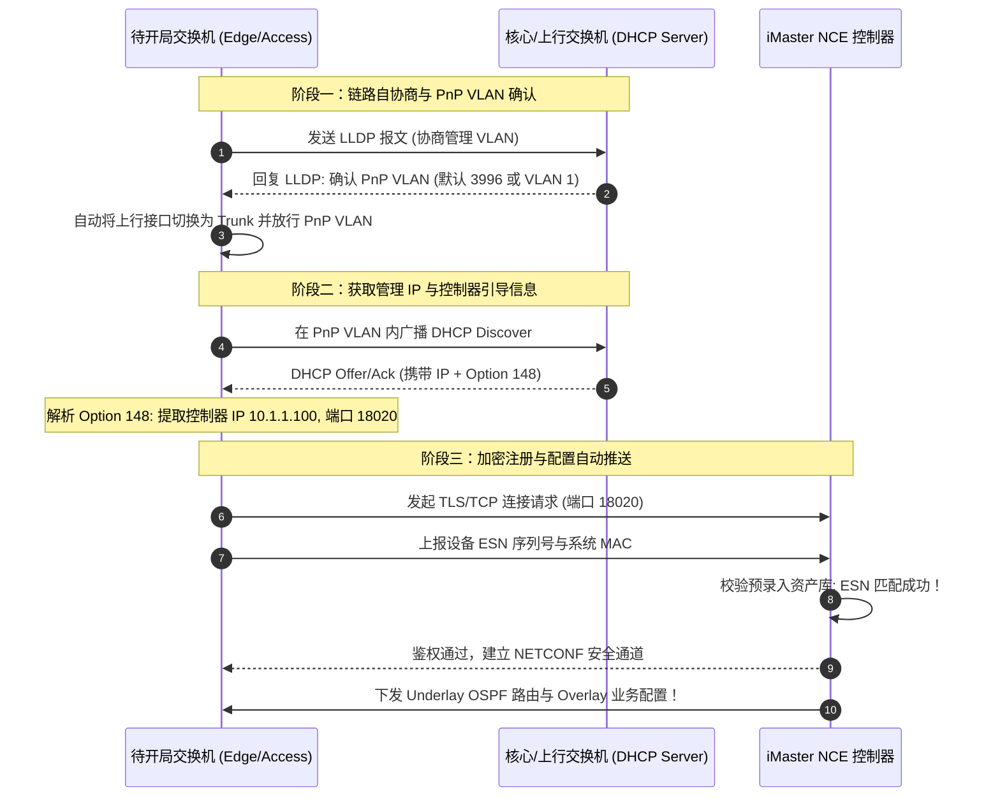

# 第31章 大中型虚拟化园区网设计

> 新一代智慧云园区（CloudCampus）设计与落地实战：从“一网多用、按需切片”的业务诉求切入，全面解构虚拟化园区网 Fabric 架构；系统剖析网络节点角色矩阵（Border / Edge / Spine / Access / 随板 AC）；推演 Underlay 自动化即插即用（PnP）开局流程（PnP VLAN、DHCP Option 148、NETCONF/TLS 自动纳管与 LLDP 拓扑还原）；对比集中式网关与分布式网关在大中型园区的容量与选型边界；详解多业务虚拟网络（VN）、IP/VNI 编址规划、海量 IoT 哑终端指纹自动识别与策略联动设计。

| 项 | 内容 |
|---|---|
| **适用层级** | HCIE 架构规划与解决方案高级设计（网络规划师/售前架构师必修、大厂园区网落地必考） |
| **建议学习位次** | 全书第 31 章，先修第 15 章（WLAN 与 DHCP）、第 26 章（VXLAN 架构）、第 27 章（EVPN 控制面）、第 30 章（业务随行与安全组）；本章是园区网顶层设计的集大成者 |
| **技术维度** | 协议原理深度剖析 · 生产级VRP配置 · 故障诊断排错 · 架构设计决策 |

---

## 一、总起

随着数字化转型深入，现代大型园区（如高科技产业园、高校智慧校园、三甲医院、政企集团总部）对网络提出了极高诉求：同一套物理网络必须同时承载行政办公、科研开发、安防监控、智能楼宇 IoT、医疗数据以及外来访客等多种业务。传统“为每个部门独立拉线建网”或“全网堆叠划分数百个 VLAN/ACL”的模式在运维成本和扩展性上彻底崩溃。

华为 **CloudCampus 大中型虚拟化园区网解决方案**，引入了数据中心成熟的 **Fabric 架构**，实现了“物理网络资源池化”与“业务逻辑网络切片解耦”：
- **物理承载网（Underlay）自动化极简构建**：物理设备支持零配置加电即用（PnP），通过 DHCP Option 148 与 LLDP 拓扑自动协商，分钟级完成控制器纳管与全网底层 IGP 路由打通；
- **虚拟逻辑网（Overlay / VN）一网多用**：将物理 Fabric 抽象切分为多个独立的虚拟网络（VN，Virtual Network）。办公 VN、监控 VN、访客 VN 相互之间在二层与三层上彻底物理级硬隔离；
- **全网集中编排与终端智能识别**：脱离传统单台设备 CLI 逐行敲命令的原始形态，全网依托 **iMaster NCE** 进行图形化意图下发、资源规划以及 IoT 终端指纹自动识别匹配。

全卷两讲聚焦于“顶层架构规划与工程落地开局”的完整脉络：
1. **Fabric 架构模型与节点角色定位**：深度解析 **Border（边界节点）**、**Edge（边缘节点）**、**Spine/Core（透明骨干）** 以及 **随板 AC / AP** 的职责边界与高可用选型；
2. **设备即插即用（PnP）自动化开局机制**：逐帧拆解交换机与 AP 加电后的“自愈上线时序”——PnP VLAN 自协商、DHCP Option 148 参数灌入、NETCONF/TLS 双向鉴权与自动化纳管；
3. **网关架构与容量规划选型**：多维度权衡“集中式网关 Fabric（网关在 Border，适合南北向外联占 80% 的中型园区）”与“分布式网关 Fabric（网关在 Edge，适合东西向内联频繁的大型园区）”的设计决策树；
4. **多 VN 业务与地址编址规范**：规划 Underlay 互联地址池、管理 IP、Overlay 业务子网、VNI 与 BD 编码映射体系；
5. **IoT 终端自动识别与策略联动**：利用 DHCP Option、HTTP User-Agent、MAC OUI 指纹库实现摄像头、打印机自动分类，配合策略联动下发受限安全策略。

**适用人群**：
- **初学 / 转行人员**：了解现代化企业是如何通过图形化控制器“不敲命令行”自动化批量开局上千台交换机；
- **备考工程师（HCIE 架构攻坚）**：彻底拿下 HCIE 面试中最高频的“虚拟化园区网集中式 vs 分布式网关选型对比”、“PnP VLAN 与 Option 148 开局流程”、“Border 节点独立 vs 合一设计”；
- **一线工程实践者**：掌握千人以上智慧园区网在前期顶层设计中的地址规划模板、哑终端准入防仿冒方案与故障应急逃生策略。

### 本章技术架构与核心脉络

| 模块序号 | 核心技术议题 | 架构要点与设计精髓 |
|:---|:---|:---|
| **§31.1** | 大中型虚拟化园区网设计1 | CloudCampus虚拟化园区网理念、Fabric即服务、物理角色与逻辑角色(Border/Edge/Access)、PnP即插即用开局流程、终端识别指纹库与策略联动 |
| **§31.2** | 大中型虚拟化园区网设计2 | PnP VLAN(3996/VLAN 1)协商机制、Option 148字段解析、随板AC与无线PnP开局、集中式vs分布式网关设计选型对比、金融行业创新与现网排错经验 |

---

## 二、分述

### 2.1 虚拟化园区网 Fabric 角色矩阵与逻辑分层

在大中型虚拟化园区网中，网络拓扑全面演进为 **Spine-Leaf（核心-接入）的 Fabric 矩阵**，设备被赋予了明确的逻辑与物理角色：

```
                           +-----------------------------------+
                           |        外部网络 / 数据中心 / 广域网   |
                           +-----------------+-----------------+
                                             │
                   ┌─────────────────────────┴─────────────────────────┐
                   │               Border 节点 (边界节点)              │
                   │          (通常由核心交换机 S12700/CloudEngine 担任) │
                   └─────────────┬───────────────────────┬─────────────┘
                                 │                       │
                                 │    Underlay 骨干      │ (Spine 纯三层转发)
                                 │                       │
                   ┌─────────────┴──────────┐ ┌──────────┴─────────────┐
                   │    Edge 节点 (边缘节点) │ │    Edge 节点 (边缘节点) │
                   │ (汇聚交换机 S6700/S5700)│ │ (汇聚交换机 S6700/S5700)│
                   └─────────────┬──────────┘ └──────────┬─────────────┘
                                 │                       │
                   ┌─────────────┴──────────┐ ┌──────────┴─────────────┐
                   │   Access 节点 (接入节点)│ │   Access 节点 (接入节点)│
                   │   (纯二层透传 S5700)    │ │   (纯二层透传 S5700)    │
                   └─────────────┬──────────┘ └──────────┬─────────────┘
                                 │                       │
                             [有线终端]              [无线 AP]
```

#### 节点核心职责定义：

| 节点名称 | 推荐硬件形态 | 核心职责与业务能力 | 是否运行 VXLAN |
|:---|:---|:---|:---:|
| **Border（边界节点）** | 框式核心交换机（S12700E / S8700 / CE） | 作为 Fabric 网络与外部网络（Internet、数据中心、分支广域网）互通的出口网关；负责路由泄露与协议转换 | **是（VTEP）** |
| **Edge（边缘节点）** | 汇聚/接入交换机（S6700 / 高端 S5700） | 终端接入 Fabric 的第一跳 VTEP 节点；负责将终端流量映射至 BD/VNI；在分布式网关中担任主机三层默认网关 | **是（VTEP）** |
| **Spine / Core（透明骨干）** | 高性能核心交换机 | 负责提供大带宽、低时延的 Underlay IP 路由转发；不感知任何 Overlay 租户业务与 VXLAN 报文内容 | **否（纯 IP 转发）** |
| **Access（接入节点）** | 二层千兆交换机（S5700 / S3700） | 物理连接桌面 PC、打印机与无线 AP；负责二层 VLAN 透传与 PoE 供电；可通过“策略联动”协同执行准入控制 | **否（纯二层透传）** |
| **随板 AC / 独立 AC** | 核心交换机内置随板 AC 模块 | 负责全网无线 AP 的集中配置管理、射频调优与终端漫游控制；与 Fabric 原生融合实现有线无线统一策略 | **配合 Edge/Border** |

---

### 2.2 即插即用（PnP）自动化开局流程详解

在拥有数百台交换机与上千台 AP 的大型园区中，手工配置 Console 线开局已经完全被自动化淘汰。**即插即用（PnP，Plug-and-Play）** 技术实现了设备“开箱上架插线、通电自动上线纳管”：

```
[设备加电] ──> 1. PnP VLAN 协商 (LLDP) ──> 2. DHCP 请求 Option 148 ──> 3. 获取控制器 IP/域名
                                                                             │
[控制器纳管] <── 5. 下发初始化配置 <── 4. NETCONF/TLS 双向鉴权注册上线 <────────┘
```



#### 关键参数：DHCP Option 148 报文剖析
DHCP 服务器在给待开局交换机分配 IP 的同时，通过 Option 148 填充一串特定格式的 ASCII 字符串：
`agilemode=tradition-mode;agilemanage-mode=ip;agilemanage-domain=10.1.1.100;agilemanage-port=18020;`
- **agilemode**：管理模式（传统云化模式）；
- **agilemanage-mode**：定位方式（支持 IP 地址或域名方式）；
- **agilemanage-domain**：iMaster NCE 控制器的南北向业务 IP 地址或 FQDN 域名；
- **agilemanage-port**：NETCONF/TLS 监听端口（华为标准默认为 **`18020`**）。

---

### 2.3 集中式网关 vs 分布式网关架构设计选型

在进行大中型虚拟化园区网规划时，网络架构师面临的最核心决策是：**网关部署在 Border 核心还是下沉至 Edge 汇聚？**

```
           集中式网关架构 (Centralized Fabric)              分布式网关架构 (Distributed Fabric)
                    [Border / 核心]                                  [Border / 核心]
                (用户默认三层网关部署在此)                            (仅负责外网出口路由互通)
                        ▲     │                                             │
               VXLAN 隧道│     │VXLAN 隧道                                   │ Overlay 骨干
                        │     ▼                                             │
                 [Edge]         [Edge]                            [Edge]         [Edge]
                 (仅二层)       (仅二层)                         (三层网关)     (三层网关)
                   │              │                                 │              │
                  PC1            PC2                               PC1            PC2
            (跨子网通信必须经核心折返)                          (同 Edge 跨子网本地直接路由转发)
```

#### 架构决策对比矩阵：

| 评估维度 | 集中式网关 Fabric | 分布式网关 Fabric |
|:---|:---|:---|
| **三层网关位置** | 部署在 **Border 核心交换机** | 下沉部署在各 **Edge 汇聚交换机** |
| **流量模型契合度** | **南北向流量占比高（>80%）**：如普通企事业单位，终端主要是上网或访问核心机房服务器 | **东西向流量占比大（>40%）**：如高科技研发、高校科研、终端之间互访频繁的场景 |
| **同 Edge 跨子网互访** | 必须封装 VXLAN 上送 Border 路由后再下发（**次优折返跑，浪费核心背板带宽**） | 本地 Edge 芯片内直接三层互连，**零网络绕行，时延微秒级** |
| **Border 硬件规格压力** | **极大**：核心需维护全网所有终端的 ARP 表项与主机路由，易成硬件瓶颈 | **极小**：核心仅维护汇聚节点的路由，全网 ARP 负载完全分散在各 Edge 上 |
| **Edge 硬件性能要求** | **低**：Edge 交换机仅需支持 VXLAN 二层网关（L2 Gateway）即可 | **高**：Edge 交换机必须支持 VXLAN 三层网关与分布式路由（L3 Gateway） |
| **推荐适用场景** | 终端规模在 **3000 台以内** 的中型园区，或利旧既有汇聚交换机的场景 | 终端规模在 **5000 ~ 50000 台** 的超大型智慧园区、大学城与集团总部 |

---

### 2.4 虚拟网络（VN）与全局资源规划

在虚拟化园区网方案中，规划阶段的工作直接决定了后续交付的成败。网络架构师必须对以下四大资源池进行严谨的前期规划：

#### 1. Underlay 基础承载网规划
- **管理 VLAN 与 IP 池**：规划专门的设备带内管理网段（如 `192.168.254.0/24`），与业务数据彻底隔离；
- **物理互联 /30 或 /31 网段**：核心与汇聚之间互联链路启用三层 Routed 接口或专用互联 VLAN，配置 OSPF/IS-IS 保证 Loopback0 全网可达；
- **VTEP Loopback 地址**：每台 Border 和 Edge 规划一个独立的 Loopback0（如 `10.1.0.x/32`），作为建立 VXLAN 隧道的源端端点 IP；
- **全网 MTU**：沿途物理端口 MTU 强制调整为 **`9216`（开启 Jumbo Frame）**。

#### 2. Overlay 虚拟网络（VN）划分规范

```
[统一物理 Fabric 基础资源池]
  ├── VN_Office (行政办公虚拟网络) ──> VPN 实例: VRF_Office ──> VNI: 10001 ~ 10010 ──> 接入员工办公
  ├── VN_RD (研发保密虚拟网络)   ──> VPN 实例: VRF_RD     ──> VNI: 20001 ~ 20010 ──> 接入代码库/研发终端
  ├── VN_Security (安防监控网络) ──> VPN 实例: VRF_Sec    ──> VNI: 30001 ~ 30010 ──> 接入视频摄像头/NVR
  └── VN_Guest (外来访客网络)    ──> VPN 实例: VRF_Guest  ──> VNI: 40001 ~ 40010 ──> 纯外网出口直连
```

每个 VN 在底层对应一个独立的 **VPN-Instance（VRF）**，分配专属的 **L3 VNI** 与一组 **L2 VNI（业务子网）**。各 VN 之间路由默认彻底隔离，若因业务需要跨 VN 互通（如办公网需调用监控摄像头），统一在 Border 节点配置安全策略与路由泄漏。

---

### 2.5 终端智能识别与策略联动机制

在现代智慧园区中，海量无交互能力的 IoT 哑终端（IP 电话、打印机、门禁、考勤机、监控摄像头）若由人工逐一采集 MAC 并配置，工作量巨大且极易出错。

```
                    +------------------------------------+
                    |        iMaster NCE 控制器          |
                    | (内置终端指纹库: 1000+ 常见设备特征)  |
                    +-----------------+------------------+
                                      ▲
                                      │ 协议特征数据上报
                                      │
                    +-----------------+------------------+
                    |           Edge / Access            |
                    |   (抓取 DHCP/HTTP/MAC/LLDP 特征)    |
                    +-----------------+------------------+
                                      ▲
                                      │ 终端发包
                                      │
                           [海量 IoT 哑终端 / 摄像头]
```

#### 终端指纹特征抓取矩阵：
1. **DHCP Option 指纹**：解析终端发送的 DHCP 请求报文中携带的 Option 55（请求参数列表）、Option 60（厂商类别标识 Vendor Class Identifier）；
2. **HTTP User-Agent 指纹**：解析终端发起 HTTP 访问时的操作系统和客户端浏览器标识；
3. **MAC OUI 指纹**：提取 MAC 地址的前 24 位，与 IEEE 官方厂商库自动比对；
4. **LLDP / CDP 报文**：解析交换机邻居发现协议中上报的系统描述与型号字段。

#### 自动化纳管流程：
- 摄像头接入交换机端口，发起 DHCP 请求；
- 接入交换机捕获 Option 60（如包含 `Hikvision` 或 `Dahua`）并上报控制器；
- 控制器比对指纹库判定为“安防监控摄像头”，自动向接入交换机下发指令：**将该端口无感划入监控 VN，并赋予安防设备安全组权限**，彻底实现 IoT 终端“即插即通、智能入网”。

---

### 2.6 常见故障排查与运维诊断命令

```shell
# 1. 查看交换机 PnP 自动开局状态与控制器连接状态
display pnp status
# 重点核查：PnP State (Success/Failed)、Server IP (10.1.1.100)、Server Port (18020)

# 2. 查看 NETCONF 会话建立状态
display netconf configuration
# 确认与 iMaster NCE 的 TLS 链接是否处于 "Connected" 状态

# 3. 查看 LLDP 邻居协商与管理 VLAN 信息
display lldp neighbor brief

# 4. 查看本地纳管的 VN 虚拟网络状态与 VNI 映射
display fabric virtual-network
# 验证：VN Name、VPN Instance Name、Associated BD/VNI 列表

# 5. 查看接入端口策略联动 (Policy Association) 运行状态
display authentication-profile configuration
```

---

## 三、总结十带走

1. **Fabric 架构本源**：将物理网络全面池化，通过 VXLAN 切分出多个业务虚拟网络（VN），实现一网多用与硬切片隔离；
2. **Border 核心定位**：边界网关，负责承接 Overlay 流量与外部网络（Internet、数据中心、分支）的三层路由打通；
3. **Edge 边缘定位**：接入第一跳 VTEP，负责把终端流量压入对应 BD/VNI，在分布式网关中下沉担任三层网关；
4. **PnP 自动化开局**：新交换机加电开箱即用，通过 LLDP 协商 PnP VLAN，彻底淘汰现场手工 Console 刷配置；
5. **Option 148 核心使命**：DHCP 报文携带控制器 IP、端口号与认证模式，指引新设备建立 NETCONF/TLS 安全隧道；
6. **集中式网关选型**：网关在 Border 核心，适合南北向外联占绝对主导（>80%）的 3000 点以下中型园区；
7. **分布式网关选型**：网关下沉至 Edge 汇聚，消除次优折返跑，适合东西向互联频繁的海量终端大型 Fabric；
8. **规划四大资源池**：前期严谨统筹规划 Underlay 互联地址、VTEP Loopback、Overlay 业务子网与 VNI 编码；
9. **Jumbo Frame 铁律**：全网物理交换机物理端口 MTU 必须强制放开至 9216，严防 VXLAN 50 字节开销导致分片丢包；
10. **IoT 终端指纹识别**：依托 DHCP Option 55/60、HTTP UA 与 MAC OUI 自动识别人偶/哑终端，动态绑定安全组。

---

## 附：本章术语速查表

| 术语（缩写） | 英文全称 | 中文标准名称 | 核心作用与定义 |
|:---|:---|:---|:---|
| **Fabric** | Network Fabric | 网络矩阵 / 架构网格 | 基于 Spine-Leaf 拓扑构建的高可靠、无阻塞、池化的物理与虚拟承载矩阵 |
| **CloudCampus** | CloudCampus Solution | 华为云园区网络解决方案 | 面向企业园区的全生命周期（规划、建设、运维、优化）云化与智能化方案 |
| **Border** | Border Node | 边界节点 | Fabric 网络的边界出口网关，实现 Overlay 内部与外部网络的三层路由打通 |
| **Edge** | Edge Node | 边缘节点 | 终端接入 Fabric 的第一跳 VTEP 交换机，负责流量接入、标签映射与策略执行 |
| **VN** | Virtual Network | 虚拟网络 | 在统一 Fabric 上切分出的逻辑网络（对应一个独立的 VRF 路由实例） |
| **PnP** | Plug and Play | 即插即用 / 零配置开局 | 设备加电后无需人工干预，通过网络自协商自动获取配置并在控制器上线的技术 |
| **Option 148** | DHCP Option 148 | 华为专用 DHCP 选项 | 用于在 DHCP 应答中携带 iMaster NCE 控制器的 IP、端口及工作模式参数 |
| **NETCONF** | Network Configuration Protocol | 网络配置协议 | 基于 XML/YANG 模型的网络设备配置与管理标准协议（RFC 6241），运行在 TLS 上 |
| **LLDP** | Link Layer Discovery Protocol | 链路层发现协议 | 标准二层邻居拓扑发现协议（802.1AB），用于 PnP VLAN 自协商与拓扑自动还原 |
| **OUI** | Organizationally Unique Identifier | 组织唯一标识符 | MAC 地址的前 24 位，由 IEEE 分配，用于快速识别终端设备的生产厂商 |
| **WAC** | Wireless Access Controller | 无线接入控制器 | 负责集中管理和控制无线 AP 的设备（在园区网中常以内置随板 AC 形式部署） |
| **CAPWAP** | Control and Provisioning of Wireless Access Points | 无线接入点控制与配置协议 | AC 与 AP 之间传输管理信令与业务数据的标准隧道封装协议（RFC 5415） |
