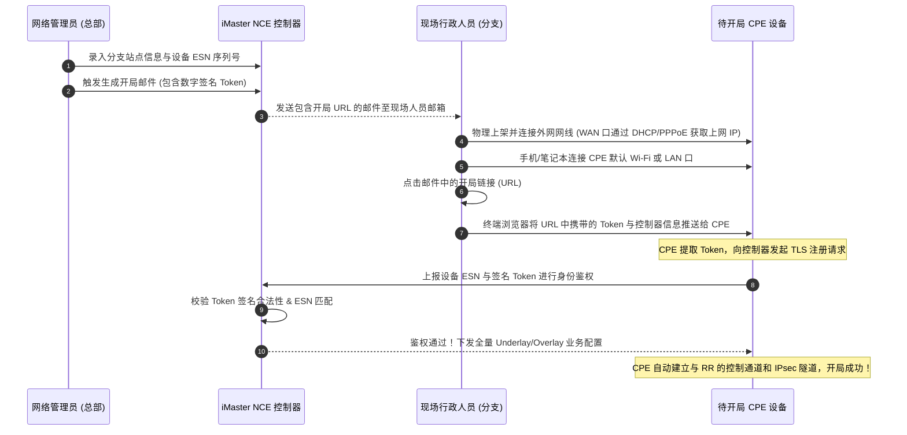

# 第32章 SD-WAN解决方案

> 广域网云化互联与降本增效的终极范式：SD-WAN 从传统专线昂贵、开通周期长与带宽利用率低三大痛点切入，深度解构混合广域网（Hybrid WAN: MPLS + Internet + 5G）的设计逻辑；系统拆解四层架构体系与四大通道模型（管理通道 / 控制通道 / 数据通道 / SLA 遥测通道）；详解 CPE 零配置开局（ZTP: 邮件开局 URL/Token 机制、DHCP Option 148 开局、U 盘开局）；攻克基于深度报文识别（DPI/SAC）与动态链路质量监测（SLA: 时延/抖动/丢包）的智能选路算法与回切机制；提供高可用双网关、Hub-Spoke 与 Mesh 拓扑规划指南与运维诊断排障矩阵。

| 项 | 内容 |
|---|---|
| **适用层级** | HCIE 广域网解决方案最高阶（架构设计必考、企业出海与多分支广域网改造核心） |
| **建议学习位次** | 全书第 32 章，先修第 16 章（NAT 与 PPP）、第 18 章（IPsec VPN 安全隧道）、第 23 章（MPLS VPN）、第 27 章（BGP EVPN 控制面）；本章是企业广域网顶层架构的巅峰之作 |
| **技术维度** | 协议原理深度剖析 · 生产级VRP配置 · 故障诊断排错 · 架构设计决策 |

---

## 一、总起

在传统的企业跨地域分支互联中，MPLS 专线长期占据统治地位。然而，随着企业业务全面上云（SaaS、公有云、混合云）以及跨国/跨省多分支机构的爆发，传统广域网陷入了三大不可承受之痛：
1. **专线资费极其昂贵且带宽受限**：MPLS 专线价格是普通 Internet 宽带的 10~20 倍以上。企业动辄数十条 10M~100M 专线，每年消耗数百万专线费用，却依然无法满足海量视频会议与云业务的带宽吞吐；
2. **专线开通与变更周期极长**：国内跨省 MPLS 专线开通通常需要 30 天，跨国专线甚至长达 90 天；企业业务急剧扩张时，网络成为业务上线的最大瓶颈；
3. **链路利用率失衡与次优绕行**：传统 WAN 通常采用“MPLS 主链路 + Internet/专线备份”模式，备用链路常年闲置浪费 50% 资源；且所有分支流量必须强行绕行总部数据中心，导致访问云端应用时延倍增。

**SD-WAN（Software-Defined Wide Area Network，软件定义广域网）** 彻底颠覆了广域网生态。它通过 SDN 技术将网络控制层与转发层彻底解耦，在廉价的底层网络之上构建起高智能、低成本、高可靠的虚拟叠加网（Overlay）：
- **混合多链路捆绑（Hybrid WAN）**：物理层将昂贵的 MPLS 专线、廉价的 Internet 宽带（光纤/PPPoE）以及 4G/5G 蜂窝链路统一池化，实现多链路主动双活与负载均衡；
- **全自动零配置开局（ZTP）**：现场非专业人员仅需插线，通过手机点击“开局邮件”中的加密链接，几分钟内自动完成整机上线并拉取业务配置；
- **基于 SLA 与业务特征的智能应用选路**：利用 DPI 深度应用识别技术，高价值业务（视频会议、ERP、金融数据）优先走低时延 MPLS 专线，大流量普通业务（文件下载、网页浏览、视频点播）智能分流至低成本 Internet 宽带；当主链路劣化时毫秒级无感切换，**在大幅提升业务体验的同时节省 50%~70% 专线资费**！

本章遵循从“商业痛点、分层架构到开局算法与实战落地”的完整闭环：
1. **技术本源与组件架构**：深度解析业务呈现层、网络控制层（iMaster NCE）、路由反射器（RR）与客户前端边缘设备（CPE）；
2. **四大通道运行模型**：拆解管理通道（NETCONF/TLS）、控制通道（BGP EVPN）、数据通道（动态 IPsec/GRE）以及 SLA 遥测通道（NQA/BFD）的协同机制；
3. **CPE 零配置开局（ZTP）深度推演**：详解**邮件开局（URL 签名 Token 授权）**、DHCP Option 148 开局与 U 盘开局的工作流程与适用边界；
4. **智能应用选路与链路保护**：深入剖析 SAC/DPI 应用特征库、SLA 质量评估指标（时延、抖动、丢包率）、选路策略与平滑回切算法；
5. **组网拓扑与双网关高可用**：对比 Hub-Spoke（星型中心辐射）与 Full-Mesh（全网对等直连）模型，提供企业双 CPE、双归属容灾与外网 NAT 出口规划最佳实践。

**适用人群**：
- **初学 / 转行人员**：了解为什么现代大企业不再花大钱租用昂贵专线，而是通过 SD-WAN 融合普通宽带实现降本增效；
- **备考工程师（HCIE 核心攻坚）**：彻底攻克 HCIE 笔试与面试中难度极高的“SD-WAN RR 节点在 BGP EVPN 中的控制面路由反射机制”、“ZTP 邮件开局的签名安全鉴权流程”、“基于 SLA 丢包率与时延的动态调整算法”；
- **一线工程实践者**：掌握跨国/跨省多分支 SD-WAN 项目从前期开局邮件制作、CPE 部署上线、应用分流策略调优到链路震荡排障的标准工程手册。

### 本章技术架构与核心脉络

| 模块序号 | 核心技术议题 | 架构要点与设计精髓 |
|:---|:---|:---|
| **§32.1** | SD-WAN解决方案概述 | 传统WAN三大痛点(贵/慢/闲)、Hybrid WAN混合链路理念、SD-WAN分层架构(呈现/控制/协同/转发)、CPE与RR角色、管理/控制/数据/SLA四大通道 |
| **§32.2** | SD-WAN解决方案与规划设计1 | Underlay多链路实验开局、MPLS+Internet混合链路配置、业务驱动网络SLA需求矩阵(在线培训视频流走MPLS/研发文件走Internet)、多租户VPN隔离 |
| **§32.1** | SD-WAN解决方案与规划设计2 | 控制平面BGP EVPN与RR路由反射机制、Overlay IPsec加密隧道建立、双网关双链路高可用冗余、Hub-Spoke与Mesh拓扑设计、集中策略编排 |
| **§32.2** | SD-WAN设备开局 | 传统开局人肉出差痛点、三大ZTP开局方式(邮件开局URL/Token机制、DHCP Option 148开局、U盘开局)、现场极简操作规范与排错 |

---

## 二、分述

### 2.1 SD-WAN 逻辑分层架构与组件矩阵

华为 SD-WAN 解决方案采用典型的云化分层解耦模型，由四大层次和核心组件构成：

```
                    +------------------------------------+
                    |        业务呈现层 (Portal 页面)     |
                    | (面向运营商 / MSP / 企业管理员的 UI) |
                    +-----------------+------------------+
                                      │
                    +-----------------+------------------+
                    |    网络控制层 (iMaster NCE 控制器)   |
                    | (策略集中编排 / 自动化配置 / SLA 分析) |
                    +--------+------------------+--------+
                             │                  │
        管理通道 (NETCONF/TLS)│                  │管理通道
                             │                  │
        ┌────────────────────┴───┐          ┌───┴────────────────────┐
        │  控制层: 路由反射器 RR  │          │  控制层: 路由反射器 RR  │
        │  (BGP EVPN 控制平面)    │          │  (主备部署, 传递拓扑/路由)│
        └────────────┬───────────┘          └───────────┬────────────┘
                     │控制通道 (BGP EVPN)                │
      ═══════════════╪══════════════════════════════════╪═══════════════
                     │                                  │
        ┌────────────┴───────────┐          ┌───────────┴────────────┐
        │   转发层: 总部 CPE      │<=========│   转发层: 分支 CPE      │
        │   (数据面 IPsec 加密)   │ 数据通道 │   (数据面 IPsec 加密)   │
        └────────────────────────┘ (Overlay)└────────────────────────┘
```

#### 组件核心职责定义：

1. **业务呈现层（Business Presentation Layer）**：
   - 提供图形化 Web Portal，面向企业管理员、MSP 服务提供商与运营商运维团队；
   - 实现全网业务模板定制、站点生命周期管理、策略可视化绘制与大屏监控；
2. **网络控制层（Network Control Layer / iMaster NCE）**：
   - SD-WAN 的“最强大脑”，负责全网设备的自动化开局纳管（ZTP）、业务拓扑编排、安全与选路策略生成，并通过 NETCONF 接口下发到 CPE 与 RR；
3. **控制层：路由反射器（Route Reflector, RR）**：
   - 部署在云端或总部数据中心的高性能核心节点；
   - 与全网所有 CPE 建立 **BGP EVPN 邻居**，负责跨站点私网路由、TLOC（传输位置信息）以及 IPsec 动态密钥信息的反射与控制，**彻底避免 CPE 之间建立全连接（Full-Mesh）BGP 的扩展性瓶颈**；
4. **转发层：客户前端设备（Customer Premises Equipment, CPE）**：
   - 部署在总部、大型数据中心或各分支机构的物理/虚拟边缘路由器（如 NetEngine AR 系列）；
   - 负责识别本地业务应用、终结数据通道隧道（IPsec / GRE）、执行报文加解密，并基于实时链路 SLA 质量执行硬件级智能选路。

---

### 2.2 四大通信通道运行模型推演

在 SD-WAN 网络中，设备间交互被清晰划分为四类功能互不干扰的逻辑通道：

```
+------------------+--------------------------+-----------------------+---------------------------------------------------+
| 通道名称         | 承载底层协议             | 通信端点              | 核心功能使命                                      |
+------------------+--------------------------+-----------------------+---------------------------------------------------+
| **1. 管理通道**  | NETCONF over TLS (18020) | CPE $\leftrightarrow$ iMaster NCE | 设备上线纳管、性能遥测数据上报、配置与策略推送     |
| **2. 控制通道**  | BGP EVPN (TCP 179)       | CPE $\leftrightarrow$ RR          | 扩散租户私网路由、站点 TLOC 信息与隧道协商参数    |
| **3. 数据通道**  | IPsec / GRE over UDP     | CPE $\leftrightarrow$ CPE         | 承载用户实际业务数据流，执行高强度加密与无损转发  |
| **4. SLA 遥测通道**| NQA / BFD 探针 (UDP)     | CPE $\leftrightarrow$ CPE         | 毫秒级探测链路时延、抖动、丢包率，驱动智能选路    |
+------------------+--------------------------+-----------------------+---------------------------------------------------+
```

---

### 2.3 零配置开局（ZTP）机制深度拆解

在传统广域网开局中，网络工程师必须携带笔记本电脑、Console 线奔波于全国各个县市的分支网点，出差成本高、耗时长、极易发生手工配置失误。**ZTP（Zero Touch Provisioning）** 实现了“现场非专业人员插线，系统自动化激活开局”。

```
                              [ZTP 三大开局方式]
           ┌──────────────────────────┼──────────────────────────┐
       邮件开局 (Email-based)      DHCP Option 148 开局         U 盘开局 (USB-based)
  (手机/电脑点击 URL, 最通用)     (依赖运营商配合, 适合特定场景)  (适用于纯私网无网络环境)
```

#### 邮件开局核心执行时序（HCIE 面试高频必考）：



> [!IMPORTANT] 邮件开局核心安全机制
> 为什么点击一个 URL 就能安全上线？开局 URL 中携带了一串经控制器私钥加密的 **Token 签名**，其中包含了：`CPE ESN`、`控制器 IP/端口`、`有效期时间戳（如 24 小时有效）` 以及 `哈希防篡改摘要`。现场即使有人拦截了邮件，只要没有对应的物理设备 ESN，或者超过了有效时间，均无法伪造上线，确保了准入的高度安全。

---

### 2.4 基于应用与 SLA 的智能选路机制

智能选路（Application-based Intelligent Traffic Steering）是 SD-WAN 降本增效的核心杀手锏。

```
                    +------------------------------------+
                    |       企业关键业务应用 (音视频)     |
                    +-----------------+------------------+
                                      │
                    +-----------------▼------------------+
                    |        SAC / DPI 深度包检测         |
                    | (精准识别: 腾讯会议/Zoom/Office365)  |
                    +-----------------+------------------+
                                      │
                         ┌────────────┴────────────┐
                         │ 实时匹配业务 SLA 策略要求 │
                         │ (要求: 时延<50ms, 丢包<1%)│
                         └────────────┬────────────┘
                                      │
               ┌──────────────────────┴──────────────────────┐
               ▼                                             ▼
     [MPLS 专线: 时延 20ms, 丢包 0%]             [Internet 宽带: 时延 80ms, 丢包 3%]
               │                                             │
               ▼                                             ▼
        【优选: 命中 SLA，主用转发】                 【备选: 暂不满足 SLA，备用就绪】
```

#### 1. 深度应用识别技术（SAC / DPI）
传统交换机/路由器仅能识别四层端口（如 TCP 80、443），无法区分网页中流淌的是重要业务还是摸鱼娱乐。
- **SAC（Smart Application Control）与 DPI（Deep Packet Inspection）**：深入分析应用层载荷的前几十到几百个字节（报文特征码、Host 字段、TLS SNI 证书扩展名），与本地集成的数千种特征库快速比对；
- 能够在毫秒级精准识别出特定业务（如区分“微信打字”、“微信语音通话”与“微信视频传输”）。

#### 2. SLA 链路质量评估模型
CPE 之间通过周期性探针（探针间隔通常为数百毫秒），持续采集各条物理链路的底层质量三项核心指标：
$$\text{链路综合健康度} = f(\text{时延 Delay},\; \text{抖动 Jitter},\; \text{丢包率 Packet Loss})$$

#### 3. 动态切换与防震荡回切算法
- **快速劣化切换**：当 MPLS 专线发生物理割接或严重拥塞导致丢包率飙升超过阈值（如连续 3 个探针周期劣于 1%）时，硬件转发表项**毫秒级直接将应用流无感重定向至 Internet 隧道**，终端用户通话无任何卡顿掉线感知；
- **延时防震荡回切（WTR，Wait to Restore）**：当 MPLS 专线修复质量恢复时，系统**坚决不立即回切**，而是启动防抖定时器（如观察稳定 5 分钟），确认专线质量彻底稳定后，再平滑将流量切回，**彻底避免链路临界抖动引发的业务剧烈震荡**！

---

### 2.5 高可用拓扑组网规划：Hub-Spoke vs Full-Mesh

```
           Hub-Spoke 模型 (中心-辐射型)                       Full-Mesh 模型 (全网状互通)
                    [总部 Hub]                                       [站点 A]
                     /      \                                        /     \
                    /        \                                      /       \
                   /          \                                    /         \
               [分支 A]      [分支 B]                          [站点 B] ===== [站点 C]
        (分支间互访必须经由总部 Hub 绕行)                 (分支与分支之间根据流量动态按需直建隧道)
```

| 维度 | Hub-Spoke 拓扑（中心辐射型） | Full-Mesh 拓扑（全互联模型） |
|:---|:---|:---|
| **隧道数量规模** | 极小，每个分支仅需与总部 Hub 建立隧道（$N$ 条） | 极大，任意两两站点均需建隧，隧道数量达 $\frac{N(N-1)}{2}$ |
| **分支间互访路径** | 经由总部 Hub 节点**二次中继转发（有额外绕行时延）** | 分支之间点对点直接通信，**零绕行，端到端超低时延** |
| **CPE 硬件规格消耗** | 分支 CPE 资源消耗低，仅总部 Hub 需大容量设备 | 全网所有 CPE 均需维护海量隧道与加解密会话，要求高 |
| **动态按需直连（DSVPN）** | 不支持动态建立 | 支持平常走 Hub，**有大流量互访时临时动态按需打洞建立直接隧道** |
| **典型推荐场景** | 90% 以上流量均为“分支访问总部机房/云端”的企业 | 分支机构之间有频繁语音通话、高密视频会议或跨区域数据备份 |

---

### 2.6 常见故障诊断与运维命令速查

```shell
# 1. 查看 CPE 在控制器的注册上线与管理通道状态
display agile-controller status
# 重点核查：Connection Status (Connected)、Controller IP、Port (18020)

# 2. 查看 CPE 与 RR 之间的 BGP EVPN 控制通道状态
display bgp evpn peer
# 验证：与 RR 的对等体状态必须为 "Established"

# 3. 查看本地建立的 Overlay 数据通道 (IPsec 隧道) 详细状态
display smart-link group 1
display ipsec sa brief
# 确认出入方向 SA (Security Association) 是否正常建立，是否有发包计数递增

# 4. 查看各条 WAN 物理链路的实时 SLA 质量探测回显 (核心排障命令)
display smart-policy-route sla-result
# 查看各链路当前的：Delay (ms)、Jitter (ms)、Packet Loss Ratio (%)

# 5. 查看特定业务应用的智能选路决策与当前命中路径
display smart-policy-route spr-index
```

---


### 2.7 硬件白盒化演进：uCPE 与 NFV 虚拟化网元

在现代跨国分支与大型企业部署中，SD-WAN 边缘网关正经历从专用专用黑盒到白盒的革新：
1. **uCPE（通用客户端设备）**：采用标准通用 x86 白盒服务器取代传统封闭路由器硬件；
2. **NFV（网络功能虚拟化）**：在 uCPE 底座上通过轻量级虚拟化或容器，动态拉起 SD-WAN 路由、虚拟防火墙（vFW）、广域网优化（WOC）等虚拟网元（VNF），分支业务升级实现“零现场硬件更迭”。

## 三、总结十带走

1. **SD-WAN 商业本源**：混合多链路（MPLS+Internet+5G）打造成本极低的 Overlay 虚拟网，节省企业 50%~70% 专线资费；
2. **四大分层角色**：呈现层管 UI、控制层（NCE）管策略、协同层（RR）管路由、转发层（CPE）管数据加解密与选路；
3. **四大通信通道**：管理通道下发配置、控制通道（BGP EVPN）同步路由、数据通道（IPsec）转发流量、SLA 通道测质量；
4. **RR 核心价值**：充当 BGP EVPN 路由反射器，集中收集并反射各站点私网路由与 TLOC，击碎全网状邻居扩展瓶颈；
5. **邮件开局（ZTP）精髓**：现场非专业人员零配置插线，手机点击邮件 URL，基于控制器数字签名 Token 秒级认证上线；
6. **SAC 深度识别**：利用 DPI 技术深入报文特征码，毫秒级精准识别出数千种细分企业应用（而非简单看端口）；
7. **SLA 动态评估**：实时监测底层链路的时延、抖动与丢包率，将关键高价值流量时刻绑定在最优质线路上；
8. **防震荡回切算法**：主链路故障时毫秒级瞬切；主链路恢复时必须经过 WTR 观察期（如稳定 5 分钟）后方可平滑回切；
9. **拓扑编排选型**：南北向云流量为主选 Hub-Spoke（控制隧道数量）；分支间高密通信选 Full-Mesh 或动态按需打洞；
10. **端到端安全基石**：Overlay 数据通道全量运行在动态协商的 IPsec 隧道之上，公网裸奔依然保证金融级通信安全。

---

## 附：本章术语速查表

| 术语（缩写） | 英文全称 | 中文标准名称 | 核心作用与定义 |
|:---|:---|:---|:---|
| **SD-WAN** | Software-Defined Wide Area Network | 软件定义广域网 | 将 SDN 理念应用于广域网互联，实现多链路池化、智能选路与云化集中管理 |
| **CPE** | Customer Premises Equipment | 客户前端设备 | 部署在企业总部或分支机构的网关路由器，负责业务接入、加解密与选路转发 |
| **RR** | Route Reflector | 路由反射器 | 部署在控制层的核心路由中继节点，通过 BGP EVPN 为全网 CPE 反射拓扑与路由 |
| **ZTP** | Zero Touch Provisioning | 零配置开局 | 设备加电插线后无需现场手动配置，通过网络自动引导完成上线纳管的技术 |
| **Hybrid WAN** | Hybrid WAN | 混合广域网 | 同时捆绑专线（MPLS）、公网宽带（Internet）及无线（LTE/5G）的互联形态 |
| **SAC** | Smart Application Control | 智能应用控制 | 华为基于 DPI 深度包检测技术的应用识别引擎，可精准识别数千种上层应用 |
| **DPI** | Deep Packet Inspection | 深度报文检测 | 深入检查数据包应用层载荷内容以识别具体业务类型的网络检测技术 |
| **SLA** | Service Level Agreement | 服务等级协议 | 衡量网络服务质量的关键指标集合（通常包括带宽、时延、抖动和丢包率） |
| **TLOC** | Transport Location | 传输位置信息 | SD-WAN 中用于标识 CPE 节点物理接入点（包含系统 IP、颜色色彩和封装类型） |
| **Hub-Spoke** | Hub-and-Spoke | 星型中心辐射拓扑 | 分支（Spoke）流量全部通过总部中心节点（Hub）中继互联的经典广域网架构 |
| **Full-Mesh** | Full Mesh | 全网状互联拓扑 | 全网任意两个分支站点之间均建立点对点直连隧道的低时延组网模式 |
| **WTR** | Wait to Restore | 恢复等待时间 | 主用链路故障恢复后，系统保持观察以防反复震荡切换的保底稳定定时器 |
