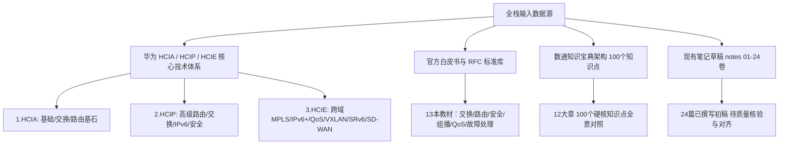

# 《华为数通工程师全栈技术专著与知识工程体系》产品需求规格说明书（PRD）

---

## 1. 文档信息与版本控制

| 属性 | 内容 |
| :--- | :--- |
| **文档名称** | 华为数通工程师全栈技术专著与知识工程体系建设需求规格说明书 (PRD) |
| **文档版本** | v1.0.0 (发布确认版) |
| **归属项目** | Datacom Full-Stack Knowledge Base (数通工程师全体系知识库) |
| **编写人** | AI 系统架构师 & 知识工程专家 |
| **审核人** | 用户 (数通工程师 / 备考与工程技术人员) |
| **创建日期** | 2026-11-09 |
| **文档状态** | 待确认 (Pending Approval) |
| **输入资产** | 华为数通全栈认证体系标准 (HCIA / HCIP / HCIE Datacom)、企业级组网白皮书与工业级生产配置规范 |

---

## 2. 项目背景与建设目标

### 2.1 现状痛点分析
1. **数通知识体系庞杂且多呈碎片化**：传统学习资料覆盖 HCIA 至 HCIE 数百个独立协议特性，常因跨层交叉分散（如路由策略、园区交换与云网 Overlay 割裂），导致工程师缺乏从物理层到自动化运维的贯通视角。
2. **知识点跨讲次交叉分散**：传统碎片化授课往往存在大量“主题混编”（如一节课前半部分讲 OSPF 特殊区域，后半部分切入 IS-IS；或前半部分讲 BGP，后半部分讲网络安全），若无系统归并，会导致知识碎片化。
3. **备考与工程实战存在鸿沟**：学员备考华为认证（HCIA/HCIP/HCIE）容易陷入“背题库死记硬背”或“纯理论缺乏现网语境”，而一线工程交付又缺乏对底层报文字段、有限状态机、转发表项深度的系统认知。
4. **现有笔记工程进度不全**：工作区已形成 01~24 卷初步成稿，但核心的高级前沿领域（卷25~32：QoS、VXLAN、EVPN、SR-MPLS、SRv6、园区网络虚拟化、业务随行、SD-WAN）以及网络自动化编程篇（卷33~35：Python自动化运维）完全缺失，尚未实现真正的“端到端全栈覆盖”。

### 2.2 建设目标
构建一套**工业级、高保真、结构化、自包含、通俗且硬核**的《华为数通工程师全栈学习笔记体系》（全集共 35 卷）。
- **技术严谨度 100%**：严格以华为 VRP 官方技术标准、RFC 协议规范与现网生产经验为准绳，绝不脱离工程语境主观杜撰。
- **体系化重构**：按“协议第一性原理—工业级配置基线—排错诊断”结构，重塑为逻辑严密的“总-分-总”技术专著。
- **三维合一视角**：每卷均融合**底层核心原理**、**VRP 官方配置命令与回显**、**现网实战案例与排错思路**、**认证考试易错避坑点**。
- **全栈闭环**：覆盖从二层以太网物理基础，到大型路由、IPv6、MPLS VPN，再到云时代 Overlay（VXLAN/EVPN）、IPv6+（SRv6）、SD-WAN，最终到 Python 网络自动化运维，形成完整的技术闭环。

---

## 3. 目标用户画像与使用场景

| 目标角色 | 典型特征与核心诉求 | 产品对应解决场景 |
| :--- | :--- | :--- |
| **初学者 / 转行人员 (HCIA 级)** | 计算机网络概念模糊，对协议封装、IP编址、交换路由缺乏直观认知。诉求：通俗生动的类比，搞懂“数据包在路上怎么跑”。 | 卷01~04、卷11、卷16：用生动的教学类比建立全局观，详解数据封装与基础二三层转发。 |
| **备考工程师 (HCIP / HCIE)** | 需攻克华为笔试、LAB实验、面试/论述题。诉求：深究协议报文字段、状态机转移、特殊场景路由环路防范、跨域VPN与新一代协议配置。 | 卷05~10（IGP/BGP全阶）、卷22~24（MPLS跨域）、卷25~32（QoS/VXLAN/EVPN/SRv6）：提供深度原理剖析、考点标注与精准命令。 |
| **一线网络工程师 / 运维人员** | 面对现网设备配置、网络割接与疑难故障排查。诉求：快速查阅典型组网模板、命令语法、故障定位排查树与工程避坑指南。 | 每卷专属的“配置与命令”模块、现网故障案例剖析、排错思路树（如路由不收敛、微环路、标签不分配等）。 |
| **网络架构师 / 售前专家** | 负责企业网、园区网、广域网顶层架构设计。诉求：技术选型对比（如 Option A/B/C 选型、SR-MPLS vs SRv6、SD-WAN 方案落地）。 | 卷30~32 虚拟化园区与 SD-WAN、卷24 跨域选型对比，提供架构对比矩阵与最佳实践决策链。 |

---

## 4. 输入资产与数据源全景梳理

全体系知识工程构建于四大支柱资产之上：

1. **官方知识库资产（Core Corpus）**：
   - `1.HCIA`：共 20 讲（涵盖通信基础、VRP系统、网络参考模型、IP编址、路由基础、OSPF、VLAN、STP等）。
   - `2.HCIP`：共 36 讲（涵盖 OSPF 深入计算、IS-IS、路由策略、BGP基础与选路、RSTP/MSTP、堆叠集群、IPv6与NDP、防火墙与VRF、VRRP与BFD、无线WLAN）。
   - `3.HCIE`：共 62 讲（涵盖 IGP高级特性、BGP高级特性、网络安全、MPLS/LDP、MPLS L3VPN及跨域A/B/C、IPv6路由与过渡、QoS、VXLAN、EVPN、企业网络全景、业务随行、虚拟化园区网、SR-MPLS、SRv6、SD-WAN官方标准教程）。
2. **补充资产与技术规范**：
   - **官方技术参考与拓展模块**：补充组播（PIM/IGMP）、高阶排错诊断、算力无损以太等深度技术细节。
   - `100个网络数通知识-v4.md`：华为《数通知识宝典》架构体系映射，作为各章节横向对比与技术广度补充。
   - `notes/_src/` & `notes/_drafts/`：已预处理切片的单讲提炼稿，支持分模块精准溯源。

---

## 5. 笔记知识体系架构与 35 卷矩阵规划

系统划分为 **8 大核心技术领域、35 个独立分卷**：

### 5.1 规划总览矩阵

| 卷号 | 分卷名称 | 适用认证层级 | 核心覆盖技术与协议 | 知识域与技术标准归属 | 状态 |
| :---: | :--- | :---: | :--- | :--- | :---: |
| **Part I: 数通基石与网络操作系统** |
| 卷01 | 网络基础与网络参考模型 | HCIA | OSI七层、TCP/IP、TCP三次握手/四次挥手、封装解封装、以太帧、MAC/ARP | HCIA 01, 05, 06, 07 | 已有初稿，待审计 |
| 卷02 | VRP系统与设备管理 | HCIA | VRP命令行、Console/Telnet/SSH、配置管理、文件传输、补丁与升级 | HCIA 02, 03, 04 | 已有初稿，待审计 |
| 卷03 | 网络层协议与IP编址 | HCIA | IPv4地址格式、子网掩码、VLSM/CIDR、ICMP报文与机制 | HCIA 08, 09 | 已有初稿，待审计 |
| 卷04 | IP路由基础 | HCIA | 路由表项（proto, pref, cost）、最长匹配原则、静态路由、路由递归与备份 | HCIA 10, 11, 12 | 已有初稿，待审计 |
| **Part II: IGP 与 BGP 大规模路由技术** |
| 卷05 | OSPF路由协议全阶 | HCIA / HCIP | 邻居建立、LSA 1/2/3/4/5/7类详解、SPF树计算、特殊区域(Stub/NSSA)、认证 | HCIA 13-14, HCIP 01-07 | 已有初稿，待审计 |
| 卷06 | IS-IS路由协议 | HCIP | CLNP/OSI体系、NET地址、Level-1/2邻接、LSP交互与CSNP/PSNP、收敛优化 | HCIP 07-12 | 已有初稿，待审计 |
| 卷07 | 路由策略与路由控制 | HCIP | ACL、IP-Prefix、Route-Policy、Filter-Policy、重分发引入与双点双向次优环路防范 | HCIP 12-14 | 已有初稿，待审计 |
| 卷08 | BGP基础与路径优选 | HCIP | BGP对等体关系、报文交互、11步选路原则、公认必遵/过渡属性、路由反射器RR | HCIP 15-21 | 已有初稿，待审计 |
| 卷09 | BGP高级特性 | HCIE | 联邦联盟、BGP ORF、团体属性(Community)、4字节AS号、BGP认证与安全特性 | HCIE 05-08 | 已有初稿，待审计 |
| 卷10 | IGP高级特性 | HCIE | OSPF/ISIS快速收敛、LFA/BGP PIC快速重路由、过载位Overload、管理距离控制 | HCIE MPLS基础与LDP协议 | 已有初稿，待审计 |
| **Part III: 园区二层交换与可靠性架构** |
| 卷11 | VLAN、VLAN间通信与ACL | HCIA | Access/Trunk/Hybrid端口模式、单臂路由、VLANIF三层转发、基本/高级ACL | HCIA 15, 16 | 已有初稿，待审计 |
| 卷12 | 生成树协议家族 (STP/RSTP/MSTP) | HCIA / HCIP | STP选举机制、端口角色与状态、RSTP快速收敛(P/A协商)、MSTP多实例防环 | HCIA 19-20, HCIP 22-24 | 已有初稿，待审计 |
| 卷13 | 链路聚合与设备堆叠 (Eth-Trunk/iStack) | HCIA / HCIP | 手工负载分担、LACP主控端选举、活动链路选定、iStack交换机堆叠与CSS集群 | HCIA 18, HCIP 25-26 | 已有初稿，待审计 |
| 卷14 | 网关与链路高可用 (VRRP与BFD) | HCIP | VRRP虚拟路由器冗余、Master选举、抢占模式、BFD毫秒级硬件探测与协议联动 | HCIP 32, 33 | 已有初稿，待审计 |
| 卷15 | 园区接入与无线技术 (DHCP与WLAN) | HCIP | DHCP工作原理、Option43/55、WLAN架构(AC+Fit AP)、CAPWAP隧道、STA上线流程 | HCIP 33-36 | 已有初稿，待审计 |
| **Part IV: 边界接入、广域网与安全技术** |
| 卷16 | 广域网接入技术 (NAT与PPP) | HCIA | 动态/静态NAT、NAPT、Easy IP、NAT Server、PPP协商过程(LCP/PAP/CHAP/IPCP) | HCIA 17, 20 | 已有初稿，待审计 |
| 卷17 | 防火墙技术与虚拟路由转发 (VRF) | HCIP | 安全区域划分(Trust/DMZ/Untrust)、安全策略、状态检测机制、多实例VRF隔离 | HCIP 30-32 | 已有初稿，待审计 |
| 卷18 | 网络安全技术与攻防防范 | HCIE | DHCP Snooping、DAI动态ARP检测、IPSG IP源防伪、URPF单播逆向路径转发 | HCIE 08-10 | 已有初稿，待审计 |
| **Part V: IPv6 全栈技术体系** |
| 卷19 | IPv6基础与编址规范 | HCIP | 128位地址划分、EUI-64生成、ICMPv6、NDP邻居发现(RS/RA/NS/NA)、DAD冲突检测 | HCIP 26-29 | 已有初稿，待审计 |
| 卷20 | IPv6动态路由协议 | HCIE | OSPFv3(链路本地LSA与拓扑分离)、IS-IS multi-topology(IPv6单/多拓扑)、BGP4+ | HCIE 21-24 | 已有初稿，待审计 |
| 卷21 | IPv6过渡技术与演进方案 | HCIE | 双栈技术(Dual-Stack)、IPv6 over IPv4手动/GRE隧道、6to4、ISATAP、NAT64 | HCIE 25-26 | 已有初稿，待审计 |
| **Part VI: 运营商与企业级 MPLS & VPN** |
| 卷22 | MPLS基础与LDP标签分发 | HCIE | MPLS报文头(Label/EXP/S/TTL)、PHP倒数第二跳弹出、LDP会话与标签映射分配 | HCIE 10-12 | 已有初稿，待审计 |
| 卷23 | MPLS L3VPN原理与部署实践 | HCIE | MP-BGP架构、RD与RT(VPN Target)机制、双层标签转发(外层LDP+内层VPNv4) | HCIE 13-17 | 已有初稿，待审计 |
| 卷24 | MPLS VPN跨域深度剖析 | HCIE | 跨域 Option A (背对背)、Option B (单层标签交换)、Option C1与C2 (端到端BGP LSP) | HCIE 18-20, 22 | 已有初稿，待审计 |
| **Part VII: 云时代前沿：Overlay、IPv6+与软件定义网络** |
| 卷25 | QoS 服务质量与流量管理 | HCIE | QoS三服务模型、DiffServ分类与标记(ToS/DSCP/CoS)、PQ/WFQ/CBQ队列、CAR监管与GTS整形 | HCIE 27-30 | **待起草编纂** |
| 卷26 | VXLAN 架构与数据中心 Overlay | HCIE | 大二层困境、VXLAN封装(UDP 4789+VNI)、NVE/VTEP网关、集中式与分布式网关模型 | HCIE 31-34 | **已编撰完成 (433行/17.5k字)** |
| 卷27 | BGP EVPN 控制平面与转发实践 | HCIE | MP-BGP EVPN各类NLRI(Type2 MAC/IP、Type3 IMET、Type5 IP前缀)、主机路由扩散 | HCIE 46-48 | **已编撰完成 (357行/14.5k字)** |
| 卷28 | Segment Routing (SR-MPLS) 技术 | HCIE | 源路由理念、SID体系(Prefix/Node/Adjacency-SID)、SR-BE与SR-TE隧道、TI-LFA保护 | HCIE 49-54 | **已编撰完成 (323行/13.6k字)** |
| 卷29 | SRv6 原理与新一代承载实践 | HCIE | IPv6扩展头SRH、128位Segment结构(Locator/Function/Args)、End/End.X/End.DT4指令 | HCIE 55-58 | **已编撰完成 (332行/14.1k字)** |
| 卷30 | 企业园区网络全景与业务随行 | HCIE | 典型企业园区网分层拓扑架构设计、业务随行(Free Mobility)、安全组与策略矩阵联动 | HCIE 35-43 | **已编撰完成 (311行/13.6k字)** |
| 卷31 | 大中型虚拟化园区网规划与设计 | HCIE | Fabric组网方案、Underlay自动化开局、Overlay二三层网络解耦、认证与接入实战 | HCIE 44-45 | **已编撰完成 (275行/12.5k字)** |
| 卷32 | SD-WAN 解决方案与智能选路 | HCIE | SD-WAN逻辑分层架构、CPE零配置开局(ZTP)、多链路捆绑负载、基于SLA的智能选路 | HCIE SD-WAN智联与SLA选路 | **已编撰完成 (273行/12.5k字)** |
| **Part VIII: 数通网络自动化与编程实战** |
| 卷33 | Python网络工程师编程基础 | HCIE 拓展 | Python环境构建、基本数据类型、字符串与IP/MAC正则表达式匹配、文件流操作 | Python 01-09 | **已编撰完成 (368行/13.0k字)** |
| 卷34 | 面向对象编程与并发处理 | HCIE 拓展 | 类与对象封装、异常处理机制、多线程/线程池并发管理海量网络设备 | Python 10-14 | **已编撰完成 (359行/13.3k字)** |
| 卷35 | Python网络自动化与Netconf/YANG | HCIE 拓展 | Paramiko SSH批量下发与巡检、Netconf/YANG原理与实战、HCIE Datacom编程机试真题解析 | Python 15-17 | **已编撰完成 (470行/17.0k字)** |

---

## 6. 功能需求规格 (FR)

### 6.1 FR-01: 单卷总-分-总标准结构规范
所有分卷文档必须严格遵守以下四层结构：
1. **卷首元信息块**：
   - 一句话定位（该技术解决什么核心痛点、在数通知识栈中的位置）。
   - 元数据表格：适用认证层级（HCIA/HCIP/HCIE）、建议学习位次、对应讲数。
2. **第一部分：总起（Overview）**：
   - 技术背景与内容全景范围。
   - 针对三类受众（新人 / 备考者 / 一线工程人员）的具体价值产出。
   - 先修技术依赖关系图/说明。
   - 本章技术架构与核心脉络表（模块节次 | 核心技术要点与工程主题）。
3. **第二部分：分述（Technical Deep-Dive）**：按业务技术逻辑细分 3~8 个子模块，每个子模块必须覆盖：
   - **核心原理**：设计初衷、协议报文、状态转移流程、生活化工程形象类比。
   - **配置与命令**：华为 VRP 标准命令块，逐条给出精确注释。
   - **现网实验与排错**：实验拓扑、验证命令（display）、典型故障场景与排错判定链。
   - **易错点与考点**：现网高频踩坑要点、HCIP/HCIE 考试常考考点。
4. **第三部分：总结与落地（Summary & Best Practices）**：
   - 核心要点精炼（5~10 条核心金句）。
   - 工程落地避坑建议（现网割接、配置互斥、硬件兼容性）。
   - 卷末术语速查表（英文缩写 | 英文全称 | 中文含义 | 关键作用）。

### 6.2 FR-02: 华为 VRP 命令与代码块规范
1. **真实性与严谨性**：所有命令必须基于华为 VRP 8.x/VRP 5.x 真实平台语法，参数范围必须准确（如 OSPF 开销 1~65535，Metric-type 1/2 等）。
2. **格式规范**：使用标准 Markdown `shell` 或 `text` 代码块，关键命令必须带有注释（例如 `# 配置接口直连网段` 或 `[R1-ospf-1] area 0` 层次化提示符）。
3. **回显与验证**：关键命令后必须附带 `display ip routing-table`、`display bgp routing-table`、`display ospf peer` 等验证回显要点解析。

### 6.3 FR-03: 工程类比与架构心法传承
1. 书中使用生动形象的工程类比（例如将“路由选路”类比为“地图导航”、将“TCP三次握手”类比为“电话确认”、“先修路后管收费站”等）以降低理解门槛，统一标注【形象工程类比】或【设计本源与技术哲学】。

### 6.4 FR-04: 全局索引与知识网状交叉
1. 提供一份总索引文档，将 35 卷按照《华为数通知识宝典》架构体系打通，标明各协议之间的协同工作机制（如 BGP 与 IGP 递归、BFD 与 VRRP/静态路由联动、VXLAN 与 BGP EVPN 协同、SRv6 与 IPv6 扩展头关系）。

---

## 7. 非功能需求规格 (NFR)

### 7.1 NFR-01: 保真红线 (Truthfulness & Zero-Hallucination)
- **硬性约束**：内容严格源于华为 VRP 官方文档、RFC 协议标准及生产级工程规范。严禁自行杜撰缺乏规范支撑的技术参数与协议行为。
- **同音字按语境精准校正**：基于专业数通知识库消除语音转写错误：
  - “录额/路额/路由器” $\rightarrow$ “路由/路由器”
  - “哦SPF / OSP / OSPF” $\rightarrow$ “OSPF”
  - “ISS / IS IS / ISIS” $\rightarrow$ “IS-IS”
  - “BDP / BPG / BGP” $\rightarrow$ “BGP”
  - “v烂 / 微烂 / Vlan” $\rightarrow$ “VLAN”
  - “交换鸡 / 交换集” $\rightarrow$ “交换机”
  - “差分 / 查分” $\rightarrow$ “拆分”

### 7.2 NFR-02: 文档自包含性 (Self-Containment)
- 每一卷必须独立成册，具备完整的阅读体验。
- 禁止使用 Obsidian 双链 `[[...]]` 或“详见卷XX”式的悬空引用；必要的前置概念必须在本卷总起或背景中给出极简要说明。

### 7.3 NFR-03: 降噪与高密度提炼 (Noise Reduction)
- 彻底剔除网课转写中的无意义口水话（“听到打1”、“上课了哈”、“对吧”、“签到一下”等）。
- 识别并剔除静音段导致的语音识别死循环幻觉文本。
- 篇幅控制在 15~35KB / 卷，排版整洁，列表优于大段冗长叙述。

### 7.4 NFR-04: 排版与可视化表现力 (Readability & Aesthetics)
- 拓扑关系使用 GitHub-Flavored Markdown 表格、ASCII 拓扑示意图或标准 Mermaid 图表（flowchart / sequenceDiagram）。
- 核心状态转移、数据帧/报文封装格式采用标准结构化图表展现。

---

## 8. 实施路线图与交付计划 (Milestones)

整个数通全栈笔记工程分为五个实施阶段：

### 阶段详细计划

| 里程碑 | 工作目标 | 产出物清单 | 验收标准 |
| :--- | :--- | :--- | :--- |
| **M1: 需求确立 (当前阶段)** | 明确全局 35 卷范围、讲次映射、技术深度与格式规范 | 《数通工程师全栈学习笔记体系_PRD.md》 | 经用户确认，分卷范围与结构无异议 |
| **M2: 存量资产审计 (卷01~24)** | 审查工作区现有 24 篇笔记，核对官方知识库覆盖度，补齐缺失配置与考点 | 规范对齐的 `01-网络基础` ~ `24-MPLS VPN跨域` 终稿 | 每篇均满足 FR-01/FR-02，排查同音字，补齐实验命令 |
| **M3: 高级前沿攻坚 (卷25~32)** | 深入 HCIE 官方知识库 27~62 讲，编撰云化网络核心：QoS、VXLAN、EVPN、SR-MPLS、SRv6、业务随行、SD-WAN | 8 篇高难度专业卷：`25-QoS` ~ `32-SD-WAN` | 涵盖底层报文、BGP EVPN Type、SRH格式、现网开局方案 |
| **M4: 自动化进阶 (卷33~35)** | 提炼 Python 基础、网络并发、Paramiko/Netconf/YANG 及 Datacom 编程机试 | 3 篇自动化实战卷：`33-Python基础` ~ `35-网络自动化` | 包含可执行的 Python 脚本范例与华为网络自动化实操 |
| **M5: 全局贯通与总装 (终审)** | 编制《全景技术知识图谱与跨卷索引目录》，建立端到端排错指南与全套知识宝典映射 | `00-全集导读与技术图谱.md`、全套 35 卷终版发布包 | 全书无死角闭环，所有命令与拓扑自洽 |

---

## 9. 风险识别与应对策略

| 风险项 | 影响范围 | 缓解应对策略 |
| :--- | :--- | :--- |
| **跨协议交叉导致的知识割裂** | 卷05/06/07/12/14/17/18/20/22 等讲次 | 采用严格的专题主题切片标记（按主题切片边界规则），仅提炼指定主题，其余部分路由至对应卷。 |
| **语音识别专业名词同音字歧义** | 命令参数与协议缩写 | 引入数通专有名词字典库（RFC标准术语与华为VRP手册），由模型在上下文中强制校验校正。 |
| **部分前沿特性（如 SRv6 / SD-WAN）协议栈跨越较大** | 卷29、卷32 | 结合华为官方解决方案白皮书与RFC标准进行严谨对齐，开放探索点如实标注【开放问题与进阶工程探索】。 |

---

## 10. 用户确认项 (Checklist for Confirmation)

请用户重点确认以下关键事项：
1. **分卷规划（35卷体系）**：是否涵盖您所需的所有数通技术领域？是否认可从 HCIA 基础到 HCIE 前沿架构（SRv6/SD-WAN）再到 Python 自动化的整体编排？
2. **单卷编写规范（总-分-总结构）**：包含原理剖析、VRP命令注释、实验与排错、易错考点、工程类比，该结构是否满足您的学习与工程查阅需求？
3. **后续推进顺序**：是否按照 **「M2: 存量01~24卷审计强化 $\rightarrow$ M3: 攻坚编撰25~32卷前沿高级特性 $\rightarrow$ M4: 编撰33~35卷自动化篇 $\rightarrow$ M5: 全集总索引与交付」** 的节奏逐步推进？
