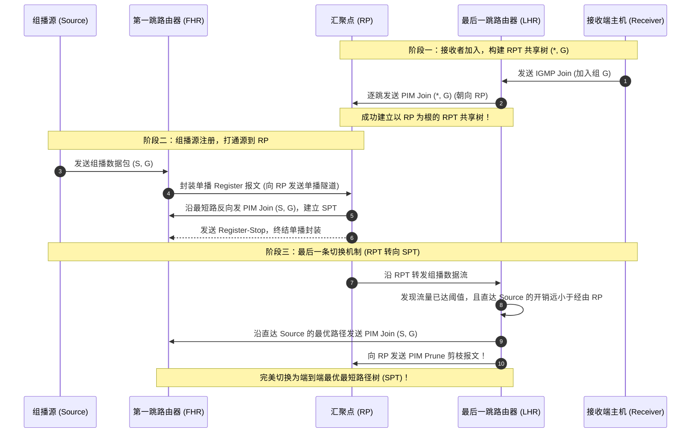

# 附录B：组播技术深度解析（IGMP 与 PIM）

> 彻底补齐数通全栈最后一公里知识盲区：从单播（点到点）与广播（泛洪）的效率痛点切入，系统拆解 IP 组播“单点发送、多点接收”的网络复用艺术；深度剖析 IPv4/IPv6 组播地址分类与以太网组播 MAC 地址映射机制（`01-00-5E` 与 32:1 重叠哈希碰撞）；详解主机与路由器交互的 IGMP 协议演进（v1 查询/v2 离组加速/v3 指定源 SSM）以及交换机 IGMP Snooping 监听机制；全面推演组播防环基石 RPF（反向路径转发检查）；深入攻克 PIM-DM（扩散-剪枝）与现代企业网主流 PIM-SM（汇聚点 RP 选举、BSR 机制、RPT 共享树到 SPT 最短路径树的无损平滑切换）。

---

## 一、组播本质定位与地址映射体系

### 1.1 三种数据传输模型对比

```
[单播 Unicast]   [源端] ──(独立复制 N 份)──> 接收端 1 / 接收端 2 / ... / 接收端 N  (极其浪费骨干带宽)
[广播 Broadcast] [源端] ──(全网无差别轰炸)──> 全网所有主机 (不管想不想要强制接收, CPU 打满)
[组播 Multicast] [源端] ──(骨干仅发 1 份)──> 路由器按需复制 ──> 仅发给加入组播组的特定成员 (最优解)
```

组播（Multicast）的核心优势是：**无论下游接收者有 10 个还是 10 万个，源端服务器到各汇聚路由器之间的主干链路上，永远只流动一份报文**；只有在网络分支分叉点，路由器才会按需复制多份下发给特定成员，是高清视频直播、金融行情推送与远程协同会议的核心支撑。

---

### 1.2 组播 IP 地址分类（D 类地址）

IPv4 组播地址最高 4 位固定为 `1110`，范围为 **`224.0.0.0 ~ 239.255.255.255`**：

| 地址范围 | 分类与作用 | 典型保留组播示例 |
|:---|:---|:---|
| **224.0.0.0 ~ 224.0.0.255** | **永久组播地址（链路本地）**<br>TTL 必须强制为 1，严禁路由器跨三层转发 | `224.0.0.1`：本网段所有主机与路由器<br>`224.0.0.2`：本网段所有路由器<br>`224.0.0.5 / 224.0.0.6`：OSPF 路由器 / DR 监听<br>`224.0.0.13`：PIM 组播路由器 |
| **224.0.1.0 ~ 238.255.255.255** | **全球通用组播地址（ASM）** | 用于跨互联网/企业跨分支的任意源组播业务传输 |
| **232.0.0.0 ~ 232.255.255.255** | **指定源组播地址（SSM）** | 专供 IGMPv3 / PIM-SSM 使用，直接指定源 IP 接收 |
| **239.0.0.0 ~ 239.255.255.255** | **管理作用域组播地址（私网组播）** | 类比 RFC 1918 私网 IP，仅在企业私网内部组播路由有效 |

---

### 1.3 组播 MAC 地址映射与“32:1 重叠冲突”

以太网网卡无法直接识别 IP 地址，必须将三层组播 IP 映射为二层组播 MAC：
- **IANA 规定标准组播 MAC 前缀**：固定为 **`01-00-5E`**（前 24 位）；
- **映射规则**：第 25 位必须固定置为 **`0`**，剩下的 **低 23 位** 直接从组播 IP 地址的低 23 位复制而来！

```
IP 组播地址:    1110 xxxx  x[后 23 位直接照搬并填充至 MAC]
MAC 组播地址:   01-00-5E-0[后 23 位来自 IP 地址]
```

> [!WARNING] 经典考点：32:1 重叠映射碰撞
> - 组播 IP 的前 4 位固定是 `1110`；
> - 映射时又丢弃了接下来的 **5 位（$32 - 4 - 23 = 5$ 位）**；
> - 这意味着存在 $2^5 = 32$ 个不同的组播 IP 地址映射为完全相同的组播 MAC 地址（例如 `224.0.1.1` 和 `224.128.1.1` 对应的 MAC 都是 `01-00-5E-00-01-01`）！
> - **工程启示**：在进行大规模组播地址规划时，**严禁将映射到同一个 MAC 的组播 IP 规划给同一局域网内的不同业务**，否则会导致网卡层误收并被迫上送 CPU 过滤，产生严重的软件开销。

---

## 二、主机与网关交互：IGMP 协议演进

IGMP（Internet Group Management Protocol，因特网组管理协议）运行在**最后一跳路由器与直连终端主机**之间：

```
                [最后一跳路由器 (Querier)]
                            │
               IGMP 查询 / 报告 (TCP/IP 协议号 2)
                            │
         ┌──────────────────┴──────────────────┐
         ▼                                     ▼
     [主机 A] (我要看 CCTV-1)              [主机 B] (我不看)
```

### 2.1 IGMPv1：基础查询与响应
- **普遍组查询（General Query）**：路由器每隔 60 秒向 `224.0.0.1` 广播一次查询；
- **成员报告（Membership Report）**：主机加入某组时发送报告；收到查询时启动随机延时定时器响应（成员报告抑制机制：同一网段只要有一台主机抢先响应，其他主机静默，减少广播）；
- **最大痛点（静默离组 Quiet-Leave）**：主机关机或退出组播时不发任何通知，路由器连续 3 次查询超时（130 秒）后才剔除该组，白白浪费 2 分钟带宽。

### 2.2 IGMPv2：主流标配（离组加速与独立查询器选举）
- **离组报文（Leave Message）**：主机退出时主动向 `224.0.0.2` 发送 Leave 报文；
- **特定组查询（Group-Specific Query）**：路由器收到后立刻向该特定组连续发送 2 次快速查询（间隔 1s），若无人响应则立即剪枝，**离开收敛从 2 分钟缩短至 2 秒**；
- **查询器选举机制**：多台路由器在同一网段时，**IP 地址最小的路由器当选为 Designated Querier（查询器）**。

### 2.3 IGMPv3：指定源组播（SSM 模型）
- 传统 ASM（Any-Source Multicast）：只要监听组播 IP，全网任何黑客向该组发包都会被推给主机，易受垃圾流攻击；
- **IGMPv3 突破**：主机在加入组 `G` 的同时，显式声明**只接收源 `S` 发来的数据**（即 `(S, G)` 模型，支持 INCLUDE / EXCLUDE 过滤列表），大幅提升安全性与路由收敛性能。

---

### 2.4 二层组播防泛洪：IGMP Snooping 机制

传统二层交换机由于无法识别三层 IP，会将组播数据帧当成广播无脑向所有端口泛洪。
- **IGMP Snooping（组播监听）**：二层交换机通过“偷听”主机与路由器之间的 IGMP 报告和离开报文，在交换机内部建立**二层组播转发表（MAC-Port 映射）**；
- 后续收到组播数据流时，交换机仅精准从连接了组播成员的物理端口转发，彻底抑制二层广播风暴！

---

## 三、组播路由协议：RPF 机制与 PIM 协议全解

### 3.1 组播防环基石：RPF（反向路径转发检查）

与单播路由“查目的 IP 决定从哪个接口送出”完全相反，**组播路由是“查源 IP 决定是否允许从该接口接收”**！

```
                        [组播源 Source (10.1.1.1)]
                                   │
                                   ▼
                            [路由器 Router]
    (入端口若是到达 10.1.1.1 的最优单播路径出接口 -> RPF 校验通过，允许转发)
    (入端口若不是到达 10.1.1.1 的最优单播路径出接口 -> RPF 校验失败，坚决丢弃！)
```

- **RPF 检查规则**：路由器收到组播包时，抓取其**源 IP 地址**，在本地单播路由表（或专用组播路由表）中查找到达该源 IP 的最优出接口；
- **如果数据包正是从该最优出接口接收进来的，则判定通过 RPF 检查**，建立下行分支复制转发；**否则立即丢弃**！从根源上杜绝了环路。

---

### 3.2 PIM 协议：PIM-DM vs PIM-SM

PIM（Protocol Independent Multicast，协议无关组播）直接利用单播路由表作为 RPF 依据，本身不维护拓扑：

```
                              [PIM 协议两大模式]
           ┌──────────────────────────────────────────┐
           ▼                                          ▼
   【PIM-DM (密集模式)】                      【PIM-SM (稀疏模式, 现代主流)】
 - 哲学: 假定全网都要，先泛洪后剪枝          - 哲学: 假定全网都不要，按需显式加入
 - 机制: 周期性扩散-剪枝(Flood-Prune)         - 核心: 引入汇聚点 RP，先建 RPT 再切 SPT
 - 适用: 局域网、组成员密集的小型网          - 适用: 跨广域网、大型企业、组成员分散
```

---

### 3.3 现代企业核心：PIM-SM 运行全流程推演

PIM-SM 围绕 **RP（Rendezvous Point，汇聚点）** 展开，是数通工程师考核与架构设计的核心：



#### 关键技术点归纳：
1. **RP 选举与宣告**：
   - 静态 RP：手工在所有路由器配置相同的 RP IP（简单但不容灾）；
   - **动态 BSR 机制（Bootstrap Router）**：Candidate-BSR 竞选出主 BSR（优先级高胜，IP 大胜），BSR 收集各 Candidate-RP 信息并周期向全网宣告 RP-Set，全网路由器通过哈希算法选举同一组 G 的主 RP；
2. **两棵树的切换**：
   - **RPT（Rendezvous Point Tree，共享树）**：表项为 `(*, G)`，由接收者向 RP 汇聚；
   - **SPT（Shortest Path Tree，最短路径树）**：表项为 `(S, G)`，由接收者最后一跳路由器（LHR）在收到首个数据包后自动触发向源端建立，**绕过 RP 中继，消除次优路径并降低 RP 负载**！

---

## 四、生产级华为 VRP 组播标准配置与排障

```shell
# ==================== [核心交换机/路由器 PIM-SM 开局] ====================
# 1. 全局使能组播路由
multicast routing-enable

# 2. 物理接口使能 PIM-SM 与 IGMP
interface GigabitEthernet0/0/1
 pim sm
#
interface GigabitEthernet0/0/2
 pim sm
 igmp enable
 igmp version 2

# 3. 配置动态 BSR / C-RP (以 Loopback0 为锚点)
pim
 c-bsr LoopBack0
 c-rp LoopBack0

# ==================== [二层交换机 IGMP Snooping] ====================
igmp-snooping enable
vlan 10
 igmp-snooping enable
```

#### 实用排错命令速查：
```shell
# 查看本地生成的组播路由表 (检查 (*, G) 与 (S, G) 表项及 RPF 入接口)
display pim routing-table

# 针对特定源进行 RPF 检查验证 (排错核心命令！)
display multicast rpf-info 10.1.1.100

# 查看二层 IGMP Snooping 端口转发表
display igmp-snooping port-info
```

---
*（附录 B 补齐了数通全栈工程体系中的组播技术断层，直通大中型音视频承载网落地实践）*
