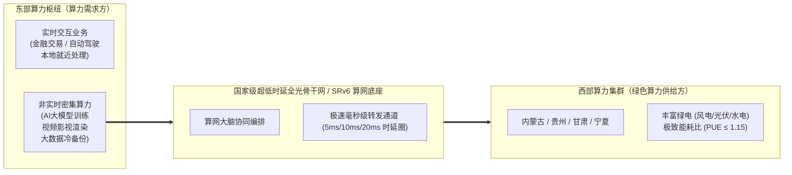
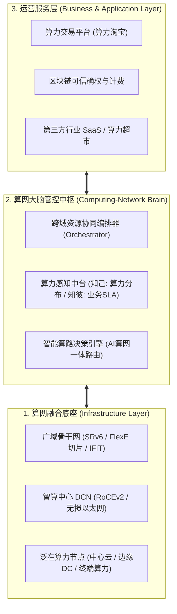
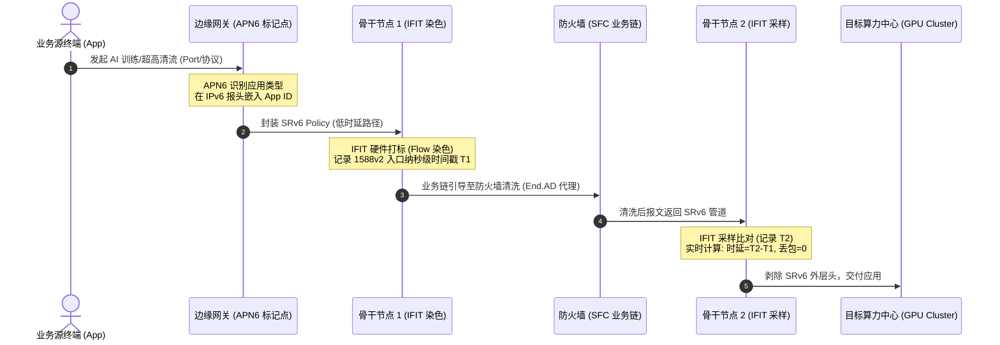
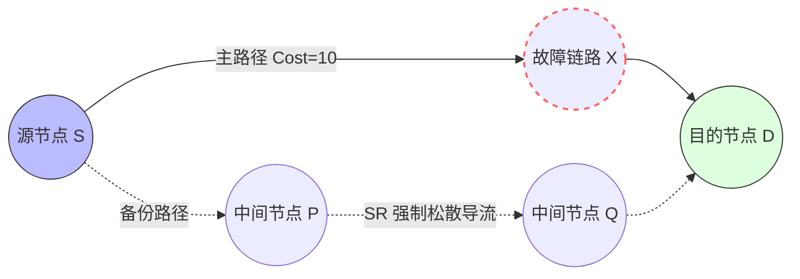
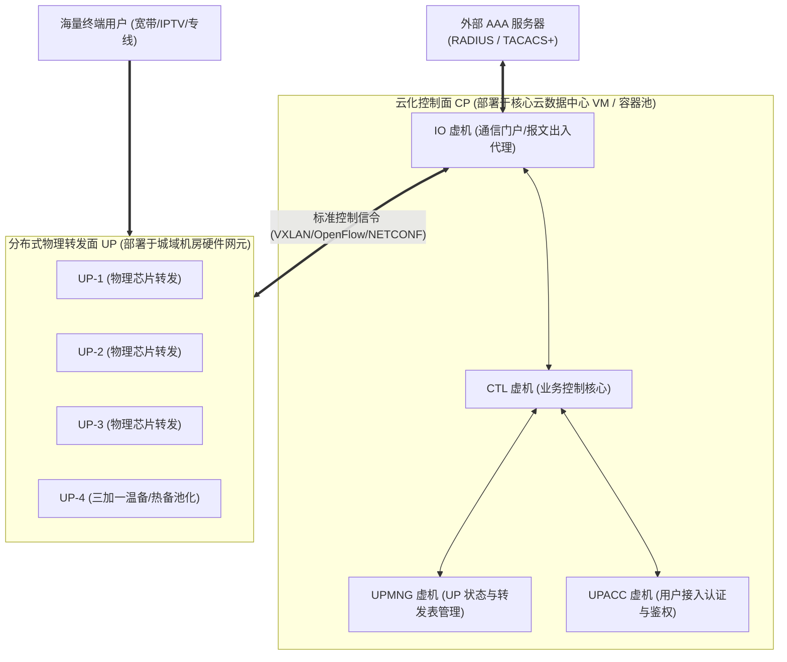
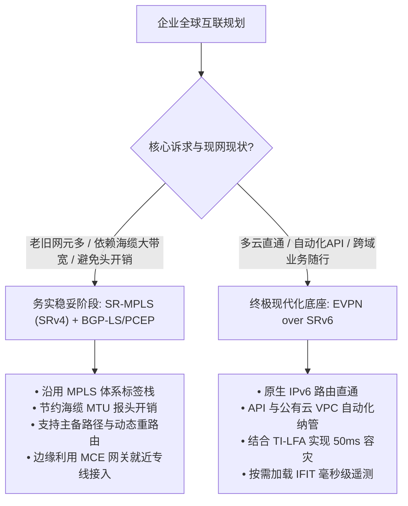

# 附录D 华为云网融合与算力网络前沿实战：IPv6+、SRv6、无损以太与CU转控分离

> **【架构定位与战略视野】**  
> 随着国家“东数西算”战略的纵深推进与 AI 大模型智算集群的爆发式增长，数据通信网络正经历从“传统连通管道”向“算力网络底座”的历史性跨越。传统 IPv4/MPLS 体系面临标签栈过深、协议冗余、跨域割裂与高丢包敏感度四大致命瓶颈。  
> 本专题基于华为云网融合与算力网络官方技术架构规范，系统解构**算力网络三层架构、智算无损以太网（RoCEv2/SPFC/AFR）、IPv6+ 创新协议族（APN6/IFIT/SFC）、TI-LFA 100% 收敛、EVPN 控制面革命、G-SRv6 报头压缩、FlexE 硬切片以及 vBNG CU 转控分离**等前沿核心技术，为数通架构师与顶级工程师提供完备的理论推演与工程实战指南。

---

## 一、宏观战略：算力网络全景与云网融合三阶段

### 1.1 算力即生产力与国家“东数西算”战略

在数字经济时代，算力已不再局限于单机运算性能，而是与国家 GDP 呈现强正相关性的核心生产力指标。
- **摩尔定律物理极限**：单芯片晶体管密度提升受限，算力增长必须依靠“多样性算力（通算、智算、超算）协同”与“分布式集群数据中心互联（DCI）”；
- **“双碳”绿色算力与 PUE 评价**：数据中心能耗指标 PUE（Power Usage Effectiveness，总能耗 / IT设备能耗）越接近 1.0 越优。华为贵州贵安数据中心依托自然冷源与直流通风，PUE 达到业界领先的 **1.12**；
- **“东数西算”工程布局**：在全国规划**八大算力枢纽**（京津冀、长三角、粤港澳、成渝、内蒙古、贵州、甘肃、宁夏）与**十大国家数据中心集群**，将东部高计算密度、低时延敏感业务（如视频渲染、AI模型离线训练、冷数据归档，即“东数西算”、“东视西炫”、“东数西训”）调度至西部富余清洁能源节点。



### 1.2 运营商云网演进三阶段

面对 OTT 公有云厂商的竞争，传统电信运营商依托遍布全国的骨干光纤与城域接入网络，加速由传统“被集成管道”向“综合算网云基础设施提供商”战略转型：

| 演进阶段 | 阶段特征 | 业务开通与交付模式 | 网络协同机制 | 典型应用形态 |
|:---|:---|:---|:---|:---|
| **第一阶段：云网协同** | 云和网相对独立，烟囱式建设 | 天级/周级，人工跨部门工单流转 | 云专线（IP RAN/PTN 静态接入），缺乏跨域联动 | 点对点云专线、普通托管机房 |
| **第二阶段：云网融合** | 统一云网运营平台，端到端打通 | 分钟级，一键式自助开通 | 集中式 SDN 控制器（BGP-LS / PCEP），网络敏捷适应虚拟机迁移 | 多云互联、VPC 云骨干网、SD-WAN 上云 |
| **第三阶段：算网一体** | 网络资源服务化，算网深度一体共生 | 秒级，任务式算力交易与自动调度 | **算网大脑**统一纳管，算网状态双向感知，“网随算动、算网共生” | 泛在算力交易市场、AI弹性推理调度 |

### 1.3 算力网络的三层标准逻辑架构

业界（中国移动、中国电信、中国联通与华为）达成了清晰的三层体系共识：



1. **算网底座**：提供泛在分布的高性能计算资源（CPU/GPU/NPU）与高可靠、低时延网络互联；
2. **算网大脑（核心管控中枢）**：负责跨域算力与网络拓扑的统一纳管、智能编排与故障自愈，对接城域网、骨干网、数据中心各专业控制器；
3. **运营服务层**：构建标准化算力交易市场，引入区块链确权防篡改，破解“算力度量无统一标准”难题。

---

## 二、智算中心网络（AIDC）：无损以太网的底层推演

### 2.1 智算效率第一性原理：丢包率与吞吐量的非线性崩溃

在大规模分布式 GPU 集群（如 DeepSeek、LLaMA、GPT 训练）中，万卡集群通过 All-Reduce 集合通信并行计算。
分布式算力效率遵循**“木桶短板定律”**：所有算力节点在每个 Step 同步梯度，若某条链路丢包触发重传，将拖慢整个集群算力。

$$\text{Throughput} \approx \min \left( \frac{\text{MSS}}{\text{RTT} \sqrt{p}}, \text{Bandwidth} \right)$$

根据经典 TCP/IP 拥塞控制模型与华为实测数据：
- **当丢包率达到 $0.1\%$ ($10^{-3}$) 时**：TCP 吞吐量将发生断崖式下跌，**有效吞吐骤降约 $90\%$**，导致千万级 GPU 算力集群近乎空转瘫痪；
- **无损以太网底线要求**：在智算场景中，网络丢包率必须达到 **$10^{-6}$ 量级甚至绝对 $0$ 丢包**，才能保障有效吞吐恢复至 $95\%$ 以上。

```
吞吐量 (Throughput %)
 100% ┌──────────────────────\
  90% │                       \
  80% │                        \
  60% │                         \
  40% │                          \
  20% │                           \
  10% │                            \─────────────── (0.1% 丢包率: 吞吐下降 90%)
   0% └─────────────┬──────────────┬───────────────
                  10⁻⁶           10⁻³            丢包率 (Packet Loss Rate)
             [无损目标区]    [致命拥塞区]
```

### 2.2 智算无损三大核心武器

#### 1. RoCEv2（RDMA over Converged Ethernet）
- **核心思想**：传统 TCP/IP 协议栈因内核态与用户态数据复制、上下文切换产生数十微秒时延；RoCEv2 采用 UDP 封装（目的端口 4791），通过网卡硬件芯片（RNIC）实现**端到端内核旁路（Kernel Bypass）与内存直访（Zero-Copy）**，将点对点通信时延压缩至微秒级（$< 2\ \mu\text{s}$）。
- **致命弱点**：RoCEv2 协议栈自身缺乏重传控制弹性，对网络底层丢包极度敏感，必须构建在底层的无损网络之上。

#### 2. SPFC（Selective Priority-based Flow Control，精细化流控）
- **传统 PFC 缺陷**：标准 802.1Qbb PFC 在检测到接收端队列缓存拥塞时，向对端发送 PAUSE 帧阻断整个 802.1p 优先级的队列。当存在不同租户/用户流量共用队列时，极易引发**PFC死锁（Deadlock）与队头阻塞（Head-of-Line Blocking）**；
- **SPFC 机制**：华为等厂商提出的增强机制，能够精准识别用户粒度或流粒度的特征，仅选择性暂停导致拥塞的恶性流量源，保障正常业务流不中断。

#### 3. AFR（Adaptive Flow Redistribution，自适应流重分配）
- 在大规模参数交换中，网络中同时存在短突发“老鼠流（Mice Flow）”与持续高带宽打满的“大象流（Elephant Flow）”；
- AFR 通过交换机本地硬件芯片实时监控出端口缓存队列深度，一旦发现大象流造成哈希极化（Hash Polarization），毫秒级通知硬件将大象流自适应漂移重哈希至空闲链路，动态平抑微突发。

---

## 三、IPv6+ 与 SRv6：云网智联核心使能技术

### 3.1 从传统隧道到源路由的降维打击

| 隧道技术 | 控制平面 | 转发开销与状态维护 | 流量工程 (TE) 能力 | 跨域与算网调度适应性 |
|:---|:---|:---|:---|:---|
| **LDP** | IGP + LDP 双协议栈 | 仅需分配内层标签，维护成本中等 | **极弱**：严格基于 IGP Cost 最短路径选路，无法按时延/SLA 调流 | 跨域需 Option B/C，配置繁琐 |
| **RSVP-TE** | IGP-TE + RSVP-TE 软状态 | **极高**：沿途所有中间节点必须维系软状态会话刷新，规模受限 | **极强**：支持带宽预留、显式松散/严格路径编排 | 扩展性极差，状态爆炸，无法跨域大规模扩展 |
| **SR-MPLS** | 仅依赖扩展 IGP (OSPF/IS-IS) | 沿途设备无状态，首节点压入标签栈 | **优异**：首节点算路并压入段列表，中间节点哑转发 | 依然受制于 MPLS 标签体系，跨 IP 公网需打通隧道 |
| **SRv6** | **无单独协议**（原生 IPv6 扩展头） | **完全无状态**：中间节点仅执行标准 IPv6 查表与扩展头更新 | **极致**：原生支持全网路径、业务链与多因子编程 | **天生跨域**：“路由可达即业务可达”，与公网/多云完美兼容 |

### 3.2 SR-MPLS 的三种段类型与 SRGB

Segment Routing 将网络路径解构为有序的指令清单（Segment ID, SID）：
1. **邻接段（Adjacency Segment）**：标识网络中某台路由器的特定物理链路。由 IGP 动态分配，本地有效；
2. **前缀段（Prefix Segment）**：标识网络中某个目的 IP 地址前缀。由管理员手工规划分配，通过 IGP 全网泛洪扩散，全局唯一；
3. **节点段（Node Segment）**：前缀段的一种特殊形式，专门指代路由器的 32 位 Loopback0 接口，用于代表整台设备；
4. **SRGB（Segment Routing Global Block）**：为 SR 前缀标签预留的全局标签空间块。
   $$\text{实际入标签值} = \text{SRGB起始值} + \text{Prefix ID}$$
   工程规范建议：**全网所有节点的 SRGB 区间必须严格规划统一**（例如统一规划为 16000 ~ 23999），以极大简化报文沿途抓包排查与故障定位复杂度。

### 3.3 SRv6 三级网络编程空间

SRv6（Segment Routing over IPv6）将段标识符直接映射为 128 位的 IPv6 地址，赋予网络前所未有的**三级可编程能力**：

```
SRv6 128-bit SID 结构编址规范:
┌──────────────────────────────┬──────────────────┬──────────────┐
│       Locator (定位块)       │ Function (操作码)│ Arguments(参)│
└──────────────────────────────┴──────────────────┴──────────────┘
 ◄──────── 64~96 bits ────────► ◄── 16~32 bits ──► ◄── 可选 ────►
```

1. **第一级：段列表编程（Segment List）**：首节点通过在 IPv6 扩展头（SRH, Segment Routing Header）中封装多个 128 位 SID 列表，编排端到端转发拓扑路径；
2. **第二级：段结构编程（SID 内部分段）**：
   - **Locator**：网络拓扑可路由前缀，中间节点通过最长匹配原则（LPM）即可路由至宿主设备；
   - **Function**：宿主设备上的指令操作码（如 `End` 转发到下一跳、`End.X` 转发到特定邻接、`End.DT4` 查特定 IPv4 VRF、`End.DX2` 透传二层）；
   - **Arguments**：操作附带参数（如指定流标记或出接口属性）；
3. **第三级：选项字段编程（Options）**：利用 SRH 中的 TLV 结构携带遥测元数据、安全认证签名或业务流控制参数。

### 3.4 算网融合三剑客：APN6、IFIT 与 SFC



1. **APN6（Application-aware IPv6 Networking，应用感知网络）**：
   - 将应用标识（App ID / SLA 诉求）直接携带在 IPv6 扩展头中；
   - 解决传统网络“网络不知业务”的黑盒问题，使网络能够在边缘就近感知任务性质（如 AI 分布式梯度同步 vs 普通网页浏览），自动映射到对应的 SRv6 Policy 管道中。
2. **IFIT（In-situ Flow Information Telemetry，随流检测）**：
   - 彻底摒弃传统 NQA 构造模拟测试包（“探针失真”）的弊端，直接对**真实业务报文的特征位（Flag）进行染色标记**；
   - 结合 gRPC/Telemetry 毫秒级上报，依托 **IEEE 1588v2 高精度时钟同步**，实现全网纳秒级单向时延探测与真正意义上的“零丢包黑匣子”精准定界。
3. **SFC（Service Function Chaining，业务链编排）**：
   - 通过 SRv6 Segment List 编排流量按需穿透防火墙（FW）、Web 应用防护（WAF）、应用交付负载均衡（LB）；
   - **非感知型服务节点（SRv6-unaware）兼容**：对于老旧防火墙，通过服务功能转发器（SFF）执行 **Proxy 代理封装与解封装**（如 `End.AS` 静态代理、`End.AD` 动态代理），无需替换现网老旧安全网元即可融入 SRv6 算网。

---

## 四、高可用与快速重路由演进：从 LFA 到 TI-LFA

网络链路故障后的收敛性能是保障算力与承载网稳定的生命线。传统的快速重路由（FRR）经历了四代演进：

### 4.1 四代 FRR 机制性能与保护率终极对比

| 机制 | 算路算法与无环约束条件 | 拓扑保护覆盖率 | 微环路（Micro-loop）风险 | 控制器依赖 |
|:---|:---|:---|:---|:---|
| **传统 LFA** | 经典不等式：$D(N, D) < D(N, S) + D(S, D)$（备份下一跳到目的地的距离小于其回到源节点的距离） | **约 70% ~ 75%** | 存在微环风险，复杂拓扑直接无解 | 否（本地算路） |
| **Remote LFA** | 计算 P 空间（源节点无环可达点）与 Q 空间（目的节点无环倒推点），建立 LDP/GRE 隧道连接 PQ 节点 | **约 96%** | 依赖 PQ 节点交集，依然存在盲区 | 否（本地算路） |
| **MRT (多拓扑)** | 维护互不相交的蓝红双拓扑树 | 100% | 协议开销巨大，全网计算复杂度高，已遭淘汰 | 否 |
| **TI-LFA (拓扑无关)** | **基于 Segment Routing 强制显式路径绕行**：自动分解 PQ 节点并在标签栈中压入 Node/Adj-SID | **100% 绝对保护** | **从数学上彻底根除微环路** | **完全去中心化**（本地 IGP 自主秒级预计算） |



### 4.2 TI-LFA 核心工程价值
1. **完全解耦物理拓扑**：无论现网物理拓扑多么不对称或开销配置多么畸形，TI-LFA 利用 SR 标签强制改变路径开销的特性，总能找到合法的无环绕行路径，**实现 100% 拓扑保护**；
2. **50 毫秒极速倒换**：所有备份路径与标签栈在故障发生前由本地 IGP 预先算好并写入硬件转发芯片（FIB），链路中断由 BFD 毫秒级触发纯数据面硬件倒换，收敛时间严格控死在 **$< 50\text{ ms}$**；
3. **去中心化抗毁性**：无需 SDN 控制器在线参与算路，杜绝了控制器失联时全网缺乏高可用保护的致命安全隐患。

---

## 五、控制平面革命：传统 VPLS 四大死穴与 EVPN 破局

在数据中心大二层与跨广域二层互联中，基于数据面广播学习的传统 VPLS（Virtual Private LAN Service）已成为阻碍网络扩展的瓶颈。

### 5.1 传统 VPLS 与现代化 EVPN 深度技术对决

| 比较维度 | 传统 VPLS 技术 | 现代 EVPN (BGP EVPN) 技术 | 工程实际影响 |
|:---|:---|:---|:---|
| **接入侧多归属模式** | **双归单活**（只能通过 STP 阻塞或 Smart-Link 阻断备用链路） | **双归双活 / 多活**（基于 ESI 实现全互联链路聚合与 ECMP 负载分担） | 带宽利用率提升 100%，消除链路浪费 |
| **故障收敛机制** | **被动泛洪收敛**：链路中断后下发 LDP 撤销 MAC，全网重新广播泛洪学习，耗时 5~10 秒 | **控制面主动收敛**：仅需 BGP 撤销一条 Type-1/Type-4 路由，远端批量切流，收敛达到 **500 ms 亚秒级** | 彻底规避收敛震荡期间大面积丢包 |
| **ARP/ND 广播处理** | **无脑全网泛洪**：任何 CE 主机发出的 ARP 请求均被复制到全网所有 PW | **ARP 代答（Suppression）**：PE 通过控制面预学习 IP/MAC 并缓存，本地直接应答 ARP，拦截泛洪 | 终结二层广播风暴隐患，解放骨干带宽 |
| **虚拟连接拓扑** | **PW 伪线全互联（Full-Mesh）**：$N$ 台 PE 需建立 $\frac{N(N-1)}{2}$ 条 PW，扩展性呈指数级恶化 | **基于 RR 路由反射**：PE 仅需与核心 RR 建立 BGP EVPN 邻居，连接复杂度从 $O(N^2)$ 骤降至 $O(N)$ | 支撑万级节点超大规模网络互联 |
| **业务融合形态** | 仅支持点对多点二层仿真 | **三合一统一承载**：一套协议同时承载 L2VPWS、L2VPLS 与 L3VPN | 大幅精简协议栈与网元运维复杂度 |

### 5.2 核心转发表项与路由协同机制

EVPN 彻底将 MAC 地址的生命周期纳入 BGP 控制面管理（**“MAC as a Route”**），在 PE 内部构建三大核心转发表：
1. **MAC VRF（单播转发表）**：由 **Type-2 路由（MAC/IP 路由）**驱动生成，记录主机 MAC、IP 与远端 VTEP/SRv6 SID 的映射；
2. **BUM 转发表（广播、未知单播、组播转发表）**：由 **Type-3 路由（集成多播路由）**驱动生成，自动建立无环泛洪隧道清单；
3. **ES 成员表（以太网段成员表）**：由 **Type-4（ES 路由）** 与 **Type-1（Auto-Discovery 路由）**驱动生成，完成跨 PE 的接入多归属识别、水平分割（Split Horizon）防环标签分配与指定转发者（DF, Designated Forwarder）选举。

---

## 六、网络切片与 CU 转控分离架构（vBNG）

### 6.1 网络切片：逻辑切片向 FlexE 硬件硬切片的跨越

面向 5G 垂直行业与智算业务隔离，数通网络切片实现了物理与逻辑的技术演进：
- **逻辑切片（QoS / VPN 实例）**：多个切片共用物理端口带宽，在突发拥塞时依靠队列调度算法（DiffServ）抢占，无法提供确定性时延与刚性带宽承诺；
- **FlexE（Flexible Ethernet，灵活以太网）硬切片**：
  - 在物理层（PHY）与链路层（MAC）之间插入 **FlexE Shim 垫层**；
  - 采用类似于 TDM 的时分复用机制，将 100GE/400GE 物理通道切分为固定的 **5Gbps 或 1Gbps 时隙（Slot）**；
  - 各切片业务独占物理时隙，**切片间时延抖动低于微秒级、带宽绝对零抢占**，达到电力差动保护、金融极速高频交易等严苛场景的物理隔离标准。

### 6.2 CU 转控分离（Control Plane & User Plane Separation）

在城域网边缘接入与宽带认证（BRAS / BNG）场景中，传统单体设备（如一体化路由器）面临控制面扩展受限、资源利用不均问题。华为与电信运营商联合推出了 **vBNG CU 分离架构**：



1. **CP（云化控制面）**：
   - 将用户认证、地址分配（DHCP）、计费、策略控制等重逻辑剥离至数据中心虚拟机集群；
   - 虚机池由 **IO 虚机**（网络交互门禁）、**CTL 虚机**（大脑调度）、**UPACC 虚机**（接入协议解析）与 **UPMNG 虚机**（设备池管理）组成，支持按需横向弹性扩展（Scale-out）；
2. **UP（物理高性能转发面）**：
   - 采用高性能通用硬件网元（如 NE40E/池化网元），仅保留硬件转发表项、QoS、CGN 与 SRv6 路由封装等数据转发逻辑；
   - 采用 **“三加一”池化热备方案**，单台物理 UP 宕机不影响用户会话状态，由备用 UP 毫秒级接管转发表；
3. **上线与转发时序闭环**：
   - 用户首次拨号（PPPoE / IPoE）报文由 UP 透传至 CP 完成 RADIUS 鉴权与 IP 分配；
   - CP 认证通过后，将最终 FIB 表项单向静态推送到 UP 硬件转发表中；
   - **随后的海量业务数据流 100% 由 UP 物理芯片线速转发，绝不经过 CP**，兼顾了集中智能与线速高吞吐。

---

## 七、现网工程权衡：G-SRv6 报头压缩与 SRv4/SRv6 选型实践

在企业全球专网与骨干跨域改造中，架构师必须进行理性的工程技术权衡（Trade-off）：

### 7.1 G-SRv6（Generalized SRv6）报头压缩的必要性与现实制约
1. **MTU 封装开销痛点**：标准 SRv6 采用 128 位（16 字节）SID。如果业务策略需要显式穿透 8 个节点，SRH 扩展头长度将达到 $16\text{ Bytes} \times 8 = 128\text{ Bytes}$。叠加外层 IPv6 基本报头（40 字节），整个封装包头高达 168 字节以上，有效载荷比率骤降至 $90\%$ 以下，严重浪费跨洋海缆等高昂带宽资源；
2. **G-SRv6 解决方案**：提取全网多个 SID 的相同前缀（Common Prefix，如 32 位或 48 位）置于最外层目的地址中，而在 Segment List 中仅传递 16 位或 32 位的压缩短段（Node ID + Function）。封装开销可缩减 **$60\% \sim 75\%$**；
3. **现网部署制约**：
   - 各网络大厂（华为、思科、中兴）在 G-SRv6 方案细节上存在私有扩展分歧，多厂商跨域互通存在壁垒；
   - 截至目前，大多数跨国企业与运营商骨干专网在带宽充足场景下仍优先采用标准 128 位 SRv6，待国际 IETF 标准彻底收敛后再行平滑启用压缩。

### 7.2 企业全球云网互联骨干的选型决策树

对于拥有遍布全球多分支、多公有云（AWS / Azure / 华为云 / 阿里云 / GCP）的企业客户：



---

## 八、本章关键工程结论速查

1. **智算无损底线**：$0.1\%$ 丢包直接导致 $90\%$ 吞吐瓦解，AIDC 算力网络必须以 $10^{-6}$ 丢包率或 RoCEv2 + SPFC 为验收及格线；
2. **SR 核心哲学**：网络状态由“中间节点维护”全面转移为“边缘节点定义”，通过源路由将网络复杂度移至边缘，中间网络全面无状态化；
3. **高可用收敛准则**：在 SR 网络中优先采用 **TI-LFA**，依靠本地 IGP 预计算实现 100% 拓扑保护覆盖与 50ms 无环秒切；
4. **EVPN 取代 VPLS**：以 BGP 作为大一统控制平面，消除二层被动广播学习，全面释放双归双活多路径与亚秒级收敛潜能；
5. **算力网络演进节奏**：先完成“云网协同与一键开通”，再推进“SRv6 算网底座与无损互联”，最终走向“算网大脑驱动的任务式算力交易”。
